# Architecture Documentation — Plugin-Based E-Commerce Platform

> Structured according to the **arc42** template (sections 1–12), with diagrams following the **C4 model**
> (Level 1 Context, Level 2 Container, Level 3 Component, Deployment) rendered as Mermaid.

| | |
|---|---|
| **System** | Self-hostable, plugin-based e-commerce platform (bachelor thesis) |
| **Repository** | `Daxrsa/bachelor-thesis` |
| **Baseline** | branch `main`, commit `c989856` (2026-09-09), plus the uncommitted `StoreBanner` component in the working tree (`webclient/src/app/store/store-banner/`) |
| **Scope** | Core API, plugin runtime, marketplace, first-party plugins, community sample plugin, plugin template, Angular web client, Docker deployment |
| **Companion documents** | [ARCHITECTURE.md](../ARCHITECTURE.md) (developer handbook and runbook), [README.md](../README.md) (quick start), [PLUGIN_AUTHOR.md](../PLUGIN_AUTHOR.md) (third-party authoring), [HELLO_PLUGIN_DIAGRAM.md](../HELLO_PLUGIN_DIAGRAM.md) (minimal plugin walkthrough) |

Every statement in this document was derived from the source code at the baseline above. Where the
implementation deviates from the intended design (for example, a field that is declared but not enforced),
this is stated explicitly and recorded as a risk or technical-debt item in [§11](#11-risks-and-technical-debt).

## Table of contents

1. [Introduction and Goals](#1-introduction-and-goals)
2. [Architecture Constraints](#2-architecture-constraints)
3. [System Scope and Context](#3-system-scope-and-context)
4. [Solution Strategy](#4-solution-strategy)
5. [Building Block View](#5-building-block-view)
6. [Runtime View](#6-runtime-view)
7. [Deployment View](#7-deployment-view)
8. [Cross-cutting Concepts](#8-cross-cutting-concepts)
9. [Architecture Decisions](#9-architecture-decisions)
10. [Quality Requirements](#10-quality-requirements)
11. [Risks and Technical Debt](#11-risks-and-technical-debt)
12. [Glossary](#12-glossary)
- [Appendix A — HTTP API Reference](#appendix-a--http-api-reference)
- [Appendix B — Source Map](#appendix-b--source-map)

### Diagram notation

All structural diagrams use C4 conventions, drawn as Mermaid flowcharts so that they render on GitHub, in
VS Code and in most Markdown-to-PDF pipelines without plugins.

| Element | Meaning |
|---|---|
| Dark blue box | Person (human actor) |
| Blue box | Software system or container **in scope** |
| Light blue box | Component inside a container |
| Grey box | External system **out of scope** |
| Cylinder | Data store |
| Solid arrow | Synchronous interaction (HTTP, SQL, Docker Engine API) |
| Dashed arrow | Asynchronous interaction (AMQP events, webhooks) or "runs / manages" |

---

## 1. Introduction and Goals

### 1.1 Purpose

The platform demonstrates that an online shop can be built as a **minimal core** (a *microkernel*) that
handles only identity, the plugin marketplace, plugin lifecycle and request routing, while **every business
capability** — product catalogue, images, cart, payment, orders, storefront widgets — is delivered as an
**independently built, versioned and deployed plugin**. Each plugin runs as its own Docker container, owns
its own database, and is installed or removed **at runtime** without rebuilding or redeploying the core.

### 1.2 Requirements overview

| ID | Capability | Realised by |
|---|---|---|
| F-01 | Register, log in and obtain a JWT; roles `user`, `publisher`, `admin` | Core — `AuthController`, `AuthService` |
| F-02 | Browse a marketplace of official and community plugins | Core — `CompositeMarketplaceCatalog` |
| F-03 | Install and uninstall plugins at runtime | Core — `PluginService`, `DockerPluginRuntime` |
| F-04 | Route client requests to installed plugins through a single entry point | Core — `PluginProxyController` and typed proxy controllers |
| F-05 | Manage the product catalogue (CRUD, filter by price and availability) | `products-plugin` |
| F-06 | Upload, list, delete and serve product images | `files-plugin` |
| F-07 | Maintain one shopping cart per user | `cart-plugin` |
| F-08 | Check out and charge the customer through Stripe (test mode) | `cart-plugin` → `payment-plugin` |
| F-09 | Create orders from successful payments; order status workflow | `order-plugin` |
| F-10 | Third-party publishing: request publisher role, publish / update / delete listings | Core — `PublisherRequestService`, `MarketplacePublishService`; Publisher Portal in the web client |
| F-11 | Restore all installed plugins after a core restart | Core — `PluginReconciliationHostedService` |
| F-12 | Storefront, admin console and publisher portal | Angular web client |

### 1.3 Quality goals

The five most important quality goals, in priority order (terminology from ISO/IEC 25010):

| Priority | Quality goal | Motivation |
|---|---|---|
| 1 | **Extensibility** (modifiability) | New features are shipped as plugins with **zero code changes** to the core. |
| 2 | **Isolation** (fault and data) | A crashing or misbehaving plugin must not take down the core or corrupt another plugin's data. |
| 3 | **Independent deployability** | Each plugin has its own image, version, database and lifecycle. |
| 4 | **Interoperability through stable contracts** | Third parties build plugins against two small, versioned contract libraries only. |
| 5 | **Recoverability** | After a restart the core restores the desired plugin state without manual reinstallation. |

Security is a stated concern, but the current implementation has significant gaps; see [§11](#11-risks-and-technical-debt).

### 1.4 Stakeholders

| Stakeholder | Expectations towards the architecture |
|---|---|
| **Customer** (shopper) | Browse products, manage a cart, pay, see payments and orders. |
| **Shop administrator / operator** | Install and remove features at runtime, manage products and orders, approve publishers. |
| **Plugin publisher** (third-party developer) | A clear contract, a project template, self-service publishing without editing the platform repository. |
| **Platform maintainer** | Understandable structure; safe evolution of the core and of the contracts. |
| **Thesis supervisor / examiner** | Traceable design rationale, explicit trade-offs, honest evaluation of limitations. |

---

## 2. Architecture Constraints

### 2.1 Technical constraints

| Constraint | Background / consequence |
|---|---|
| **.NET 10 / C# (latest)** for the core and all bundled plugins | Set centrally in [Directory.Build.props](../backend/Directory.Build.props) (`net10.0`, nullable enabled). |
| **ASP.NET Core** — MVC controllers in the core, minimal APIs in plugins | Controllers give the core rich OpenAPI metadata; minimal APIs keep plugins small. |
| **PostgreSQL 16** (`postgres:16-alpine`) is the only supported plugin database engine | [DockerPluginRuntime](../backend/src/ECommerce.PluginRuntime/DockerPluginRuntime.cs) throws `NotSupportedException` for any other `database.engine`. |
| **RabbitMQ 3** (AMQP 0-9-1, client `RabbitMQ.Client` 7.2) | Sole asynchronous integration channel between plugins. |
| **Docker Engine** reachable over a Unix socket | The core needs `/var/run/docker.sock`; in Compose the socket is bind-mounted into the API container. |
| **OCI registry** for plugin images | `registry:2` on `localhost:5000` during development. |
| **Angular 21**, PrimeNG 21 (Sakai template, Aura theme), Tailwind CSS 4 | Web client; zoneless change detection, standalone components. |
| **Stripe** (`Stripe.net` 52) in test mode | Only payment provider; test payment-method tokens are used. |
| **Single Docker host** | No Kubernetes / Swarm; scheduling, scaling and multi-host networking are out of scope. |

### 2.2 Organisational constraints

| Constraint | Background |
|---|---|
| Single-developer bachelor thesis, monorepo | Core, plugins, template, contracts and web client live in one repository. |
| Plugins are language-agnostic **by contract** | The runtime contract is HTTP + Docker image + JSON manifest. All bundled plugins happen to be .NET. |
| Third parties must not need the monorepo | Contracts are packable as NuGet packages; a `dotnet new` template and a Publisher Portal exist. |
| Local development on macOS / Linux with Docker Desktop | Drives the dual networking mode described in [§7.2](#72-dual-networking-mode). |

### 2.3 Conventions

| Convention | Rule | Source |
|---|---|---|
| Plugin id | `^[a-z0-9]+(?:-[a-z0-9]+)*-plugin$` | [PluginIdRules.cs](../backend/src/ECommerce.PluginRuntime/PluginIdRules.cs) |
| Plugin process | Listens on `0.0.0.0:8080`, exposes `GET /health` → `200` | [README.md](../README.md), template |
| Image name | `localhost:5000/ecommerce/<id>:<version>` | [catalog.json](../backend/marketplace/catalog.json) |
| Container names | `ecom-plugin-<id>`, `ecom-plugin-<id>-db`, volumes `ecom-plugin-<id>-data` / `-storage` | [PluginRuntimeOptions.cs](../backend/src/ECommerce.PluginRuntime/PluginRuntimeOptions.cs) |
| Event names | `<aggregate>.<past-tense-verb>.v<major>` (e.g. `payment.succeeded.v1`) | [EventNames.cs](../backend/src/ECommerce.IntegrationContracts/V1/EventNames.cs) |
| Plugin internal layering | `Api` → `Application` → `Domain`, plus `Infrastructure` | `backend/plugins/*-plugin/` |
| Contract evolution | Additive changes within `V1`; breaking changes require a new namespace (`V2`) | [IntegrationContracts README](../backend/src/ECommerce.IntegrationContracts/README.md) |

---

## 3. System Scope and Context

### 3.1 Business context (C4 Level 1)

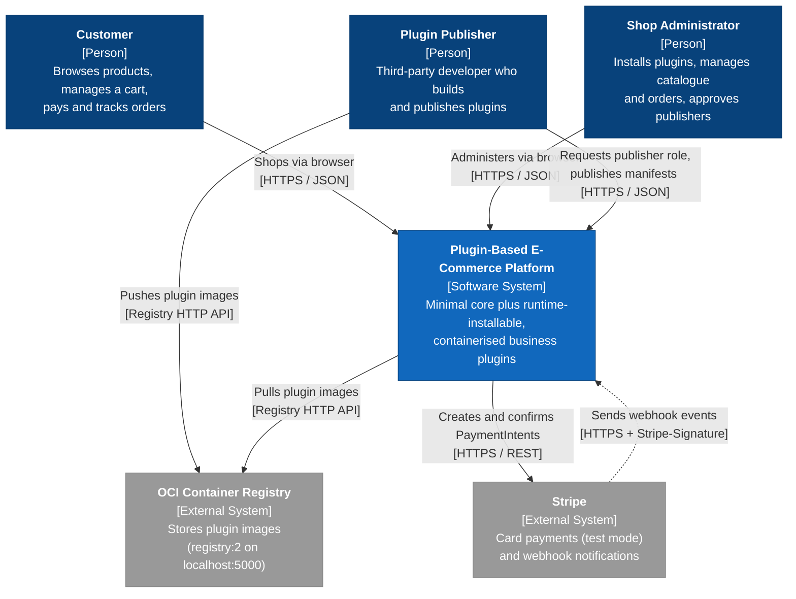

| Partner | Input to the platform | Output from the platform |
|---|---|---|
| Customer | Credentials, cart operations, checkout (currency, payment method) | Product catalogue, cart, payment history, orders |
| Shop administrator | Install / uninstall commands, product data and images, order status changes, publisher approvals | Marketplace, installation state, dashboards |
| Plugin publisher | Publisher request, plugin manifest (`plugin.json`) | Listing status, installation state of own listings |
| Stripe | PaymentIntent results, signed webhook events | PaymentIntent create-and-confirm requests |
| Container registry | Plugin images | Image pull requests |

> The registry runs as a Compose service during development, but it is treated as **external** because in
> production it would be any OCI registry (Docker Hub, GHCR, a private registry) owned by plugin publishers.

### 3.2 Technical context

| Channel | From → To | Protocol / format | Port |
|---|---|---|---|
| Web API | Browser (Angular SPA) → Core API | HTTP/JSON, `Authorization: Bearer <JWT>` | 8080 |
| Plugin traffic | Core API → plugin container | HTTP/JSON (or multipart), identity in `X-User-Id` / `X-User-Email` | 8080 (container) |
| Container orchestration | Core API → Docker Engine | Docker Engine REST API over `unix:///var/run/docker.sock` | — |
| Image distribution | Docker Engine → registry | Docker Registry HTTP API v2 | 5000 |
| Core persistence | Core API → core PostgreSQL | PostgreSQL wire protocol (Npgsql, EF Core) | 5432 |
| Plugin persistence | Plugin → its own PostgreSQL sidecar | PostgreSQL wire protocol | 5432 (container) |
| Integration events | Plugin ↔ RabbitMQ | AMQP 0-9-1, JSON envelope, topic exchange | 5672 |
| Payments | `payment-plugin` → Stripe | HTTPS REST via `Stripe.net` | 443 |
| Webhooks | Stripe → Core API → `payment-plugin` | HTTPS POST, raw JSON body + `Stripe-Signature` | 8080 |
| Broker management | Operator → RabbitMQ UI | HTTP | 15672 |

---

## 4. Solution Strategy

The architecture combines a small number of well-known styles. The table maps each quality goal or key
problem to the chosen approach and to where it is realised.

| Goal / problem | Approach | Realisation |
|---|---|---|
| Extensibility (QG 1) | **Microkernel architecture**: the core contains only cross-cutting platform services; all business features are plugins. | `backend/src/*` (core) vs. `backend/plugins/*`, `backend/community/*` |
| Isolation (QG 2) | **Out-of-process plugins**, one Docker container per plugin on a dedicated bridge network; **database per plugin** as a runtime-provisioned PostgreSQL sidecar. | [DockerPluginRuntime](../backend/src/ECommerce.PluginRuntime/DockerPluginRuntime.cs) |
| Runtime installation (F-03) | The core **drives the Docker Engine API** directly (Docker.DotNet). The desired state is persisted in `PluginInstallations`. | [PluginService](../backend/src/ECommerce.Api/Plugins/PluginService.cs) |
| Single entry point, uniform security (F-04) | **API gateway / reverse proxy** inside the core under `/api/p/{pluginId}/…`; JWT is terminated at the gateway and identity is forwarded as headers (**trusted subsystem**). | [PluginProxyController](../backend/src/ECommerce.Api/Controllers/PluginProxyController.cs) |
| Loose coupling between plugins (QG 3) | **Event-driven choreography** over a RabbitMQ topic exchange; no plugin-to-plugin HTTP calls. The checkout is a choreographed **saga**. | `Infrastructure/Messaging` in each plugin |
| Stable integration surface (QG 4) | Two **versioned contract libraries**: `PluginContracts` (manifest) and `IntegrationContracts` (event envelope + payloads). Packable as NuGet. | `backend/src/ECommerce.*Contracts` |
| Discovery and third-party publishing (F-02, F-10) | **Composite marketplace**: official file-based catalogue plus community listings in the database; official ids always win. | [CompositeMarketplaceCatalog](../backend/src/ECommerce.PluginRuntime/CompositeMarketplaceCatalog.cs) |
| Recoverability (QG 5) | **Reconciliation** of desired state (database) against actual state (Docker) at start-up — inspired by Kubernetes controllers. | [PluginReconciliationHostedService](../backend/src/ECommerce.Api/Plugins/PluginReconciliationHostedService.cs) |
| Consistency without distributed transactions | **Eventual consistency** with idempotent consumers and **local read projections** (e.g. product prices inside `payment-plugin`). | [PaymentService](../backend/plugins/payment-plugin/Application/Payments/PaymentService.cs), [OrderService](../backend/plugins/order-plugin/Application/Orders/OrderService.cs) |
| Developer experience for third parties | `dotnet new ecommerce-plugin` template, NuGet-packed contracts, Publisher Portal. | [templates/ecommerce-plugin](../backend/templates/ecommerce-plugin/), [PLUGIN_AUTHOR.md](../PLUGIN_AUTHOR.md) |

**Technology decisions in one sentence each:** ASP.NET Core on .NET 10 for core and plugins (one language,
strong tooling); PostgreSQL for every relational store (one operational skill set); RabbitMQ topic exchange
for events (routing by event name, durable queues, mature .NET client); Docker Engine API instead of an
orchestrator (fits a single-host thesis scope); Angular + PrimeNG for a feature-rich admin UI with little
custom styling.

---

## 5. Building Block View

### 5.1 Level 1 — Whitebox of the overall system (C4 Container)

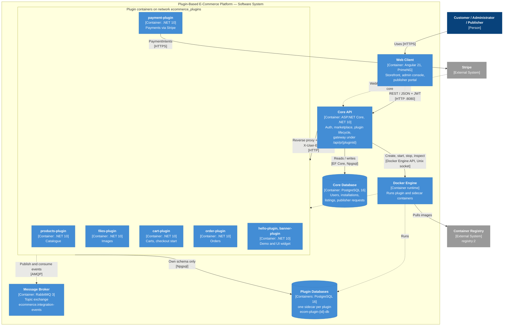

| Container | Technology | Responsibility | Source |
|---|---|---|---|
| **Web Client** | Angular 21, PrimeNG 21, Tailwind 4 | Storefront (`/store`), admin console (`/`), publisher portal (`/publisher`), auth pages | [webclient/](../webclient/) |
| **Core API** | ASP.NET Core (.NET 10), EF Core, Docker.DotNet | Identity, marketplace, plugin lifecycle, reconciliation, HTTP gateway | [backend/src/ECommerce.Api](../backend/src/ECommerce.Api/) |
| **Core Database** | PostgreSQL 16 | Platform state: users, installations, community listings, publisher requests | [AppDbContext](../backend/src/ECommerce.Infrastructure/AppDbContext.cs) |
| **Docker Engine** | Docker | Executes plugin and sidecar containers on behalf of the core | — |
| **Message Broker** | RabbitMQ 3 (management image) | Asynchronous integration between plugins; the core never connects to it | [docker-compose.yml](../backend/docker-compose.yml) |
| **Plugin containers** | ASP.NET Core minimal APIs | One bounded context each (see [§5.3](#53-level-2--plugins)) | [backend/plugins](../backend/plugins/), [backend/community](../backend/community/) |
| **Plugin Databases** | PostgreSQL 16 sidecars | Private persistence of a single plugin | Created by [DockerPluginRuntime](../backend/src/ECommerce.PluginRuntime/DockerPluginRuntime.cs) |

> **Notable property:** the core does **not** reference `ECommerce.IntegrationContracts` and never opens an
> AMQP connection. It only injects broker coordinates into plugin containers. Business events are a concern
> of plugins alone, which keeps the kernel independent of the business domain.

### 5.2 Level 2 — Core API (C4 Component)

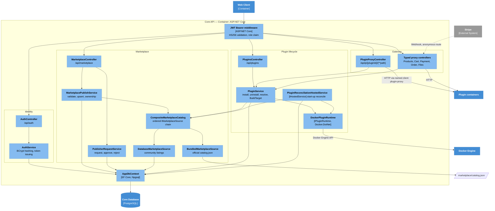

| Component | Responsibility | Source |
|---|---|---|
| Composition root | Loads `.env`, configures JWT, CORS, EF Core, DI, OpenAPI; `EnsureCreated`; bootstraps the admin account; serves static files | [Program.cs](../backend/src/ECommerce.Api/Program.cs) |
| `AuthController` / `AuthService` | Register, login, `me`, role management; BCrypt password hashes; HS256 JWT with `sub`, `email`, `role` | [AuthController.cs](../backend/src/ECommerce.Api/Controllers/AuthController.cs), [AuthService.cs](../backend/src/ECommerce.Api/Auth/AuthService.cs) |
| `PluginsController` / `PluginService` | Marketplace listing, installed list, install (permission check, persist, start), uninstall, endpoint resolution | [PluginsController.cs](../backend/src/ECommerce.Api/Controllers/PluginsController.cs), [PluginService.cs](../backend/src/ECommerce.Api/Plugins/PluginService.cs) |
| `DockerPluginRuntime` | Network, sidecar database, image pull, container create/start, health wait, reconcile, stop | [DockerPluginRuntime.cs](../backend/src/ECommerce.PluginRuntime/DockerPluginRuntime.cs) |
| `PluginReconciliationHostedService` | Once at start-up: align every installation with Docker and refresh host/port | [PluginReconciliationHostedService.cs](../backend/src/ECommerce.Api/Plugins/PluginReconciliationHostedService.cs) |
| `CompositeMarketplaceCatalog` | Merge ordered sources; skip failing sources; first source wins on id collision; sort by id | [CompositeMarketplaceCatalog.cs](../backend/src/ECommerce.PluginRuntime/CompositeMarketplaceCatalog.cs) |
| `BundledMarketplaceSource` | Read official manifests from `catalog.json`; drop invalid ids | [BundledMarketplaceSource.cs](../backend/src/ECommerce.PluginRuntime/BundledMarketplaceSource.cs) |
| `DatabaseMarketplaceSource` | Map `MarketplaceListings` rows (JSON columns) to manifests | [DatabaseMarketplaceSource.cs](../backend/src/ECommerce.Api/Plugins/DatabaseMarketplaceSource.cs) |
| `MarketplacePublishService` | Validate manifests; protect official ids; enforce listing ownership | [MarketplacePublishService.cs](../backend/src/ECommerce.Api/Plugins/MarketplacePublishService.cs) |
| `PublisherRequestService` | Publisher-role request workflow (`pending` → `approved` / `rejected`) | [PublisherRequestService.cs](../backend/src/ECommerce.Api/Plugins/PublisherRequestService.cs) |
| `PluginProxyController` | Generic reverse proxy for any installed plugin; anonymous route for public images | [PluginProxyController.cs](../backend/src/ECommerce.Api/Controllers/PluginProxyController.cs) |
| Typed proxy controllers | Strongly-typed, OpenAPI-documented routes for first-party plugins; replace `me` with the caller id; checkout orchestration; Stripe webhook relay | [ProductsPluginController.cs](../backend/src/ECommerce.Api/Controllers/ProductsPluginController.cs), [CartPluginController.cs](../backend/src/ECommerce.Api/Controllers/CartPluginController.cs), [PaymentPluginController.cs](../backend/src/ECommerce.Api/Controllers/PaymentPluginController.cs), [OrderPluginController.cs](../backend/src/ECommerce.Api/Controllers/OrderPluginController.cs), [FilesPluginController.cs](../backend/src/ECommerce.Api/Controllers/FilesPluginController.cs) |
| `AppDbContext` | EF Core model of the core database | [AppDbContext.cs](../backend/src/ECommerce.Infrastructure/AppDbContext.cs) |

#### .NET project structure

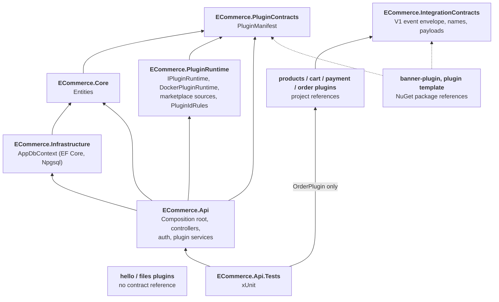

The dependency direction keeps the **contracts at the bottom** with no dependencies of their own. Plugins
never reference core projects — they depend only on contracts, which is the essential condition for
independent deployability.

### 5.3 Level 2 — Plugins

#### 5.3.1 Plugin anatomy (common internal structure)

All business plugins follow the same layered structure. The minimal plugins (`hello-plugin`,
`banner-plugin`, the template) collapse everything into a single `Program.cs`.

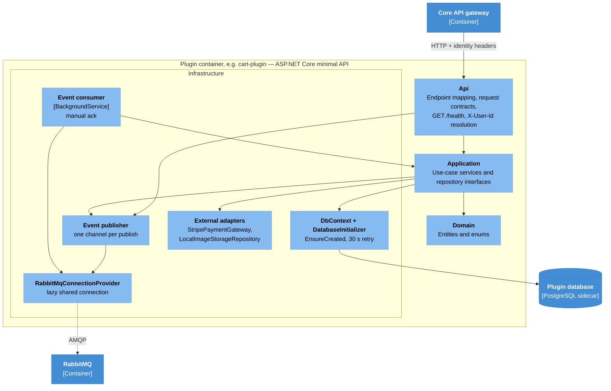

#### 5.3.2 Plugin catalogue

| Plugin | Version / origin | Database sidecar | Volume | Publishes | Consumes | Main HTTP surface (inside the container) |
|---|---|---|---|---|---|---|
| `hello-plugin` | 0.1.0, official | — | — | — | — | `GET /greeting` |
| `products-plugin` | 0.1.0, official | `products` | — | `product.upserted.v1`, `product.deleted.v1` | — | `GET/POST /products`, `GET/PUT/DELETE /products/{id}` (filters `minPrice`, `maxPrice`, `availability`) |
| `files-plugin` | 0.1.0, official | `files` (declared, **unused**) | `/app/storage` | — | — | `POST/GET /files/images`, `GET/DELETE /files/images/{fileName}`, static `/static/images/*` |
| `cart-plugin` | 0.1.0, official | `cart` | — | `cart.product-added.v1`, `cart.product-removed.v1`, `cart.checkout-requested.v1` | `cart.product-added.v1`, `cart.product-removed.v1`, `payment.succeeded.v1`, `order.created.v1` | `GET/DELETE /carts/{userId}`, `POST /carts/{userId}/items`, `DELETE /carts/{userId}/items/{productId}`, `GET …/items/count`, `POST /carts/me/checkout` |
| `payment-plugin` | 0.1.0, official | `payment` | — | `payment.succeeded.v1`, `payment.failed.v1` | `product.upserted.v1`, `product.deleted.v1`, `cart.checkout-requested.v1` | `GET /payments/me`, `POST /webhooks/stripe`, `GET /webhooks/stripe/events` |
| `order-plugin` | 0.1.0, official | `orders` | — | `order.created.v1` | `payment.succeeded.v1` | `GET /orders`, `GET /orders/me`, `GET /orders/me/{id}`, `PATCH /orders/{id}/status` |
| `banner-plugin` | 1.0.0, **community** (published via the portal, not in `catalog.json`) | — | — | — | — | `GET /banner` |

Every plugin also exposes `GET /health`; plugins with a database (e.g. products, cart) report `503` until
the database is reachable. Official manifests live in [catalog.json](../backend/marketplace/catalog.json);
each plugin keeps a copy as `plugin.json` next to its sources.

#### 5.3.3 Plugin-specific design notes

| Plugin | Key design decisions | Source |
|---|---|---|
| **products-plugin** | Owns the catalogue. Endpoints save first, then publish `product.upserted.v1` / `product.deleted.v1` (currency fixed to `USD`). On first start the initializer seeds 10 demo products — **without** publishing events. Enums serialise as `INSTOCK` / `LOWSTOCK` / `OUTOFSTOCK`; categories `Electronics`, `Tools`, `Accessories`; price precision (12,2). | [ProductsEndpoints.cs](../backend/plugins/products-plugin/Api/ProductsEndpoints.cs), [ProductsDatabaseInitializer.cs](../backend/plugins/products-plugin/Infrastructure/ProductsDatabaseInitializer.cs) |
| **files-plugin** | File-system backed on a named volume; no database access despite the manifest. Upload validation: ≤ 5 MB, `image/jpeg`, `png`, `webp`, `gif` (configurable via `FileValidation`). Stored name `{slug}-{guid}{ext}`; `Path.GetFileName` prevents path traversal. Files are served by the static-file middleware. | [FilesEndpoints.cs](../backend/plugins/files-plugin/Api/FilesEndpoints.cs), [LocalImageStorageRepository.cs](../backend/plugins/files-plugin/Infrastructure/Storage/LocalImageStorageRepository.cs) |
| **cart-plugin** | **Command-via-event** write path: HTTP endpoints validate, publish an event and return `202 Accepted`; the plugin's own consumer applies the change. This serialises writes through the queue. A cart is deleted on `payment.succeeded.v1` / `order.created.v1` **only if** the event's `CartId` matches the current cart. | [CartEndpoints.cs](../backend/plugins/cart-plugin/Api/CartEndpoints.cs), [CartService.cs](../backend/plugins/cart-plugin/Application/Carts/CartService.cs) |
| **payment-plugin** | Keeps a local **price projection** fed by product events, so prices are never taken from the client or the cart. Idempotent per checkout `CorrelationId`. Stripe `PaymentIntent` with `Confirm = true` and test tokens (`pm_card_visa`, or `pm_card_chargeDeclined` when the method is `declined`). Webhooks are signature-verified and de-duplicated by Stripe event id. | [PaymentService.cs](../backend/plugins/payment-plugin/Application/Payments/PaymentService.cs), [StripePaymentGateway.cs](../backend/plugins/payment-plugin/Infrastructure/Stripe/StripePaymentGateway.cs), [PaymentEndpoints.cs](../backend/plugins/payment-plugin/Api/PaymentEndpoints.cs) |
| **order-plugin** | Creates an order only from `payment.succeeded.v1` after validating user, cart, payment id, line totals and grand total. Idempotent per `PaymentId`. Status enum `Processed`, `Accepted`, `Dispatched`, `Completed` stored as string (legacy `Paid` maps to `Processed`); no transition rules are enforced. | [OrderService.cs](../backend/plugins/order-plugin/Application/Orders/OrderService.cs), [OrderMessaging.cs](../backend/plugins/order-plugin/Infrastructure/Messaging/OrderMessaging.cs) |
| **hello / banner / template** | Dependency-free minimal plugins that demonstrate the contract: `/health`, one business endpoint, identity from `X-User-Email`. | [hello-plugin](../backend/plugins/hello-plugin/Program.cs), [banner-plugin](../backend/community/banner-plugin/Program.cs), [template](../backend/templates/ecommerce-plugin/Program.cs) |

### 5.4 Level 2 — Contracts

The two contract libraries are the only code shared between the core and plugins. They are deliberately
small, dependency-free and packable as NuGet packages (`dotnet pack`, see [PLUGIN_AUTHOR.md](../PLUGIN_AUTHOR.md)).

#### 5.4.1 Plugin manifest — `ECommerce.PluginContracts`

Source: [PluginManifest.cs](../backend/src/ECommerce.PluginContracts/PluginManifest.cs). The manifest is the
contract between a plugin and the **core** (lifecycle). It is published as `plugin.json`.

| Field | Default | Used for | Enforcement status |
|---|---|---|---|
| `id` | — (required) | Routing key `/api/p/{id}`, container names, uniqueness | Validated against the id rule on publish and when loading `catalog.json` |
| `name`, `description`, `publisher` | — (required) | Marketplace display | Required on publish |
| `version` | — (required) | Stored on the installation; container label `ecommerce.plugin.version` | A changed version makes reconciliation recreate the container |
| `image` | — (required) | Image pulled by the Docker Engine | Pull failure falls back to a local image |
| `containerPort` | `8080` | Proxy target port | Must be > 0 on publish |
| `healthEndpoint` | `/health` | Readiness polling after start (1 s interval, 30 s timeout) | Required on publish |
| `hostApi` | `^1.0.0` | Intended compatible core API range | **Declared only — not evaluated** |
| `permissions` | `[]` | Capabilities the installer must grant | Install fails unless **all** are granted; **not enforced at runtime** |
| `database` | `null` | Sidecar PostgreSQL: `engine`, `image`, `databaseName`, `username`, `password`, `port`, `volumeMountPath` | Only `postgres` supported |
| `storage` | `null` | Named volume mounted at `volumeMountPath` (default `/app/storage`) | — |
| `uiExtensions` | `{}` | Map of UI slot → remote entry URL (micro-frontend hook) | Persisted and editable; **not consumed by the web client yet** |

#### 5.4.2 Integration events — `ECommerce.IntegrationContracts.V1`

Source: [V1/](../backend/src/ECommerce.IntegrationContracts/V1/). This is the contract **between plugins**.
Every message is an `IntegrationEventEnvelope<TPayload>`:

| Envelope field | Meaning |
|---|---|
| `EventName` | Routing key, e.g. `cart.checkout-requested.v1` |
| `SchemaVersion` | `"1.0"` |
| `EventId` | Unique message id (also AMQP `MessageId`) |
| `OccurredAtUtc` | Producer timestamp |
| `CorrelationId` | Business-transaction id carried through a saga (also AMQP `CorrelationId`) |
| `CausationId` | `EventId` of the message that caused this one (optional) |
| `ResourceIds` | `ProductId`, `CartId`, `UserId`, `PaymentId`, `OrderId` — used for routing decisions and idempotency |
| `Payload` | Event-specific record, transport-safe primitives only |

The event catalogue and topology are described in [§8.3](#83-integration-events-and-messaging).

### 5.5 Level 2 — Web Client

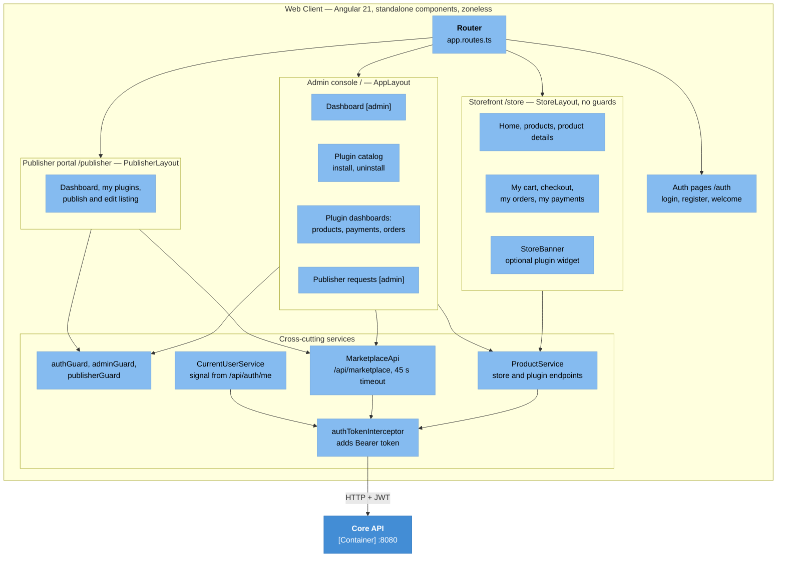

| Area | Routes | Guards | Main backend calls | Source |
|---|---|---|---|---|
| Storefront | `/store`, `/store/products`, `/store/products/:id`, `/store/my-cart`, `/store/checkout`, `/store/my-orders`, `/store/my-payments` | none | products, cart, payment, order, files, banner plugins via `/api/p/…` | [store.routes.ts](../webclient/src/app/store/store.routes.ts) |
| Admin console | `/` (dashboard), `/plugin-catalog`, `/plugin-catalog/{products,payment,order}-plugin`, `/publisher-requests` | `authGuard`, `adminGuard` (dashboard, publisher requests) | `/api/plugins`, `/api/marketplace`, plugin endpoints | [admin.routes.ts](../webclient/src/app/admin/admin.routes.ts) |
| Publisher portal | `/publisher`, `/publisher/plugins`, `/publisher/plugins/new`, `/publisher/plugins/:pluginId` | `authGuard`, `publisherGuard` | `/api/marketplace/listings*`, `/api/marketplace/publisher-requests*` | [marketplace.api.ts](../webclient/src/app/pages/publisher/marketplace.api.ts) |
| Auth | `/auth/login`, `/auth/register`, `/auth/welcome`, `/auth/access`, `/auth/error` | `authGuard` (welcome) | `/api/auth/*` | [webclient/src/app/auth](../webclient/src/app/auth/) |

Client-side architecture rules:

- **Single backend origin.** All calls go to the core (`http://localhost:8080`); the SPA never talks to a
  plugin directly. The interceptor attaches the token only for that origin.
- **Token handling.** The JWT is stored in `localStorage` (`ecommerce.token`); the role is decoded on the
  client for guards and menu, but **authorisation is decided by the server**.
- **Eventual consistency in the UI.** After asynchronous cart mutations (`202 Accepted`), the client
  re-reads the cart counter after 1.2 s ([product.service.ts](../webclient/src/app/pages/service/product.service.ts)).
- **Graceful degradation of plugin-backed widgets.** `StoreBanner` hides itself on any error, so the
  storefront works whether or not `banner-plugin` is installed ([store-banner.ts](../webclient/src/app/store/store-banner/store-banner.ts)).
- **Static composition.** Plugin pages are compiled into the SPA; the menu ([app.menu.ts](../webclient/src/app/layout/component/app.menu.ts))
  is role-driven, not driven by installed plugins or `uiExtensions` (see [§11](#11-risks-and-technical-debt)).

---

## 6. Runtime View

The scenarios below were chosen because they exercise the architecturally significant mechanisms:
runtime installation, recovery, request routing, asynchronous writes, the checkout saga, failure handling,
cross-plugin data flow, third-party publishing and graceful degradation.

### 6.1 Installing a plugin

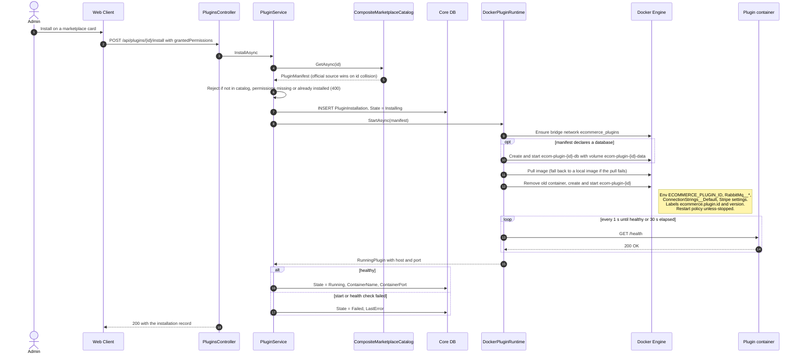

The installation request is **synchronous**: it returns only after the container is healthy or has
failed. Uninstalling (`DELETE /api/plugins/{id}`) stops and removes the plugin and database containers
(errors are logged, not surfaced) and deletes the installation row; **named volumes are kept**, so a
reinstall finds its previous data.

### 6.2 Start-up reconciliation

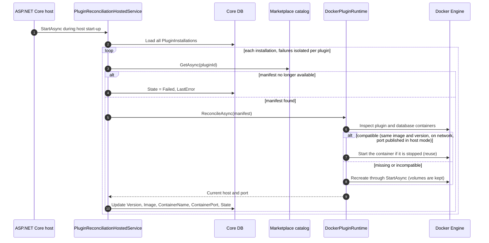

Reconciliation runs **once** per process start. It also transparently adapts plugin endpoints when the
core switches between running inside Compose and running on the host ([§7.2](#72-dual-networking-mode)).
Behaviour is covered by
[PluginReconciliationHostedServiceTests](../backend/tests/ECommerce.Api.Tests/PluginReconciliationHostedServiceTests.cs).

### 6.3 Proxied request through the gateway

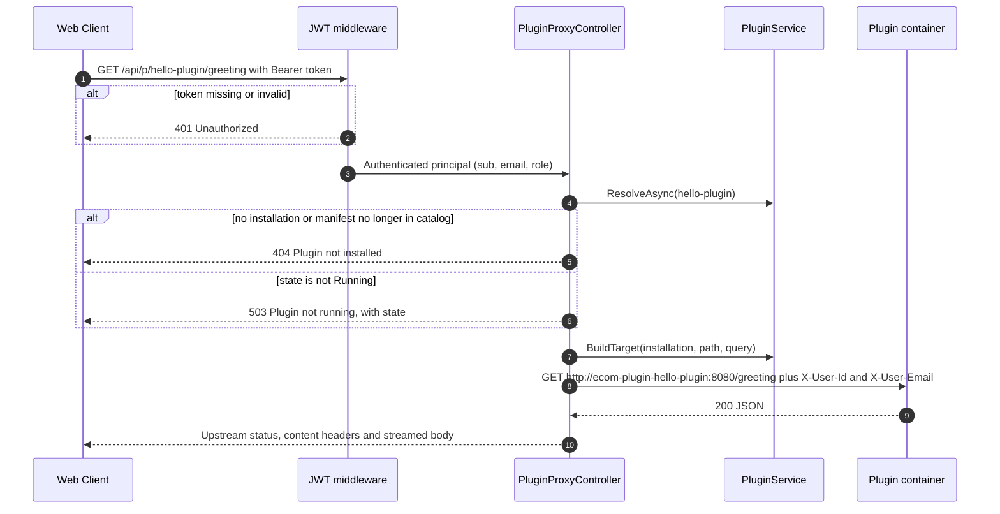

- Request bodies are buffered; multipart bodies are re-assembled in memory before forwarding.
- Responses are streamed (`HttpCompletionOption.ResponseHeadersRead`); `Transfer-Encoding` is stripped.
- `GET /api/p/files-plugin/static/images/{**path}` is the only **anonymous** proxy route, so `` tags
  work without a token.
- **Typed proxy controllers** take precedence over the generic route for first-party paths. They map
  `me` to the caller's `sub` claim (e.g. `/api/p/cart-plugin/carts/me` → `carts/{userId}`). A request for
  another user's id still reaches `cart-plugin` through the generic route, but `cart-plugin` uses
  `X-User-Id` in preference to the path id, so a client cannot address another user's cart through the
  gateway.

### 6.4 Adding a product to the cart (asynchronous write)

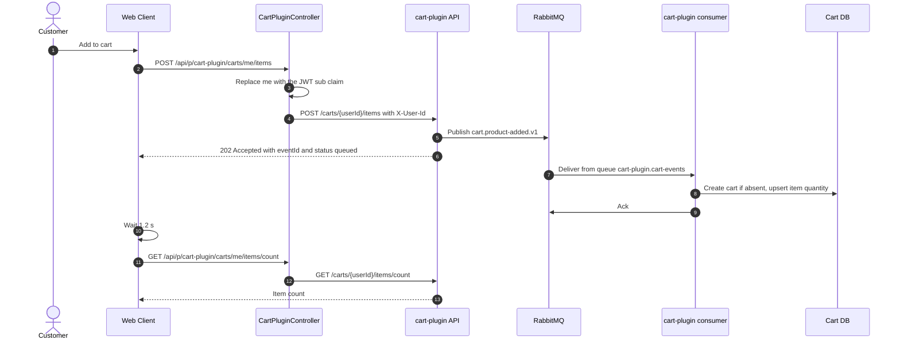

### 6.5 Checkout saga — happy path

The checkout is a **choreographed saga**: no component orchestrates the business transaction end-to-end;
each plugin reacts to events and emits new ones. The `CorrelationId` created at checkout links all steps.

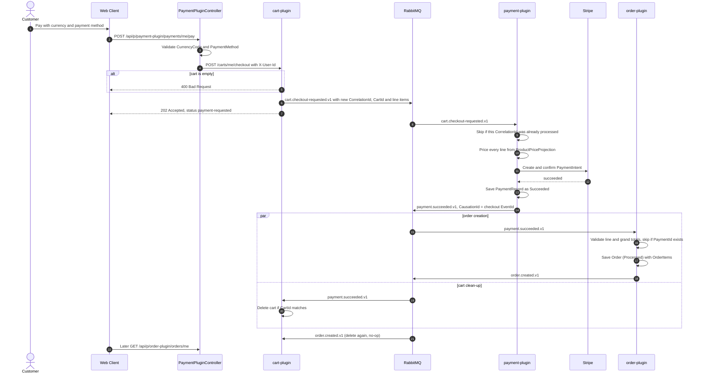

Observations:

- The **core starts** the saga (the payment endpoint forwards to `cart-plugin`), which couples the core to
  two specific plugins — see [ADR-010](#adr-010--typed-proxy-controllers-for-first-party-plugins).
- **Prices are authoritative on the server**: the cart only carries product ids and quantities; the amount
  is computed by `payment-plugin` from its projection.
- The UI learns the outcome by reading `/payments/me` and `/orders/me`; there is no push channel.

### 6.6 Payment failure and Stripe webhooks

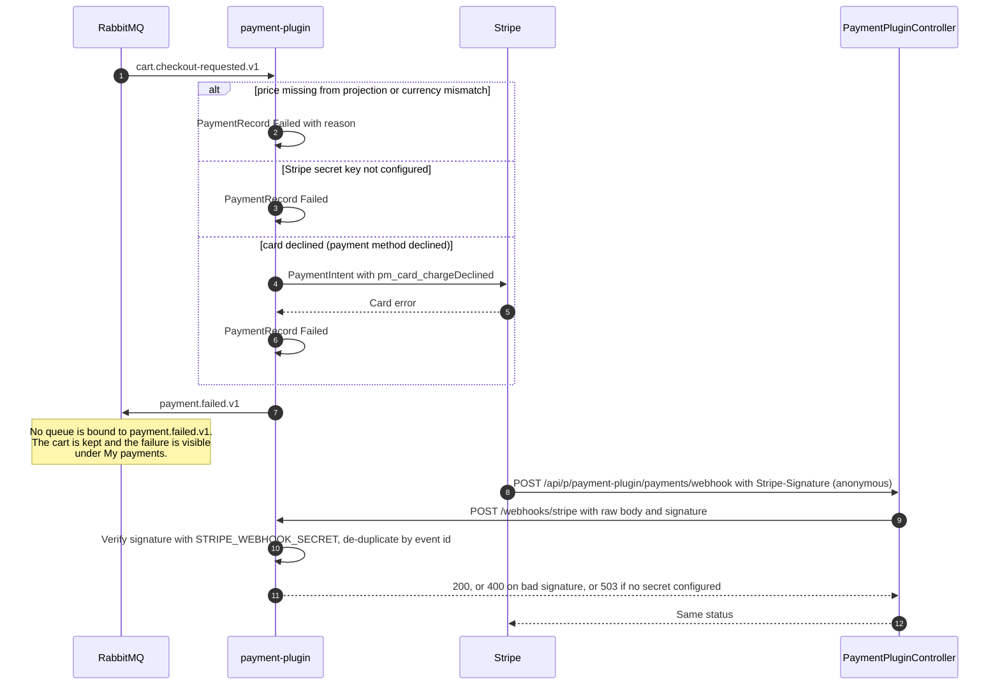

Webhooks are stored for auditing (`StripeWebhookEvents`) but do **not** change payment state — the
synchronous `PaymentIntent` confirmation is the source of truth.

### 6.7 Product image upload and cross-plugin data flow

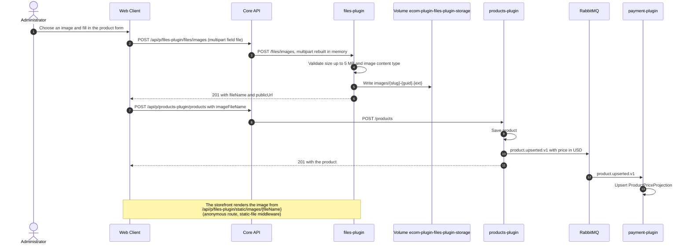

The two plugins never call each other: the **client** composes them (file name returned by one plugin is
stored in the other), and `payment-plugin` learns prices through **events**.

### 6.8 Publisher onboarding and publishing a community plugin

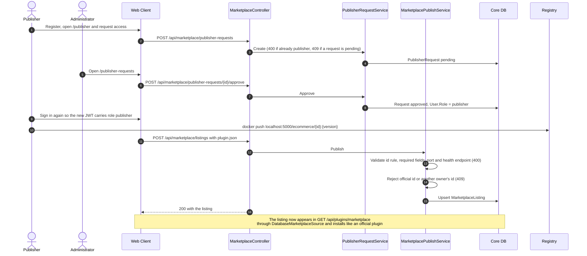

`banner-plugin` in [backend/community](../backend/community/banner-plugin/) is the reference example of
this flow; it is intentionally absent from `catalog.json`.

### 6.9 Optional plugin widget — graceful degradation

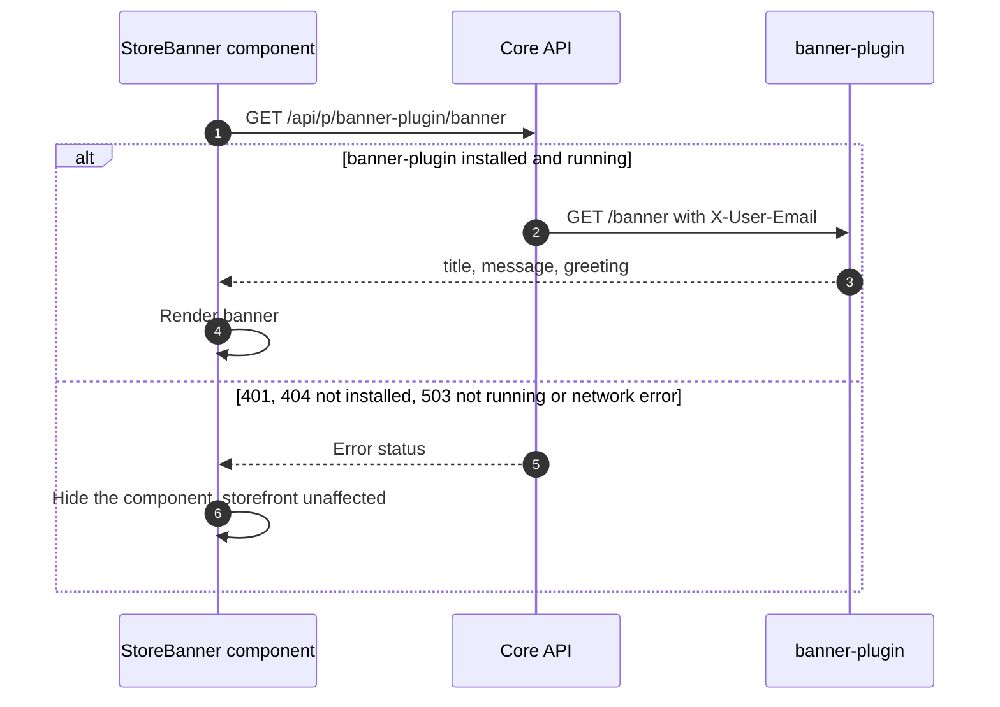

### 6.10 Plugin installation state machine

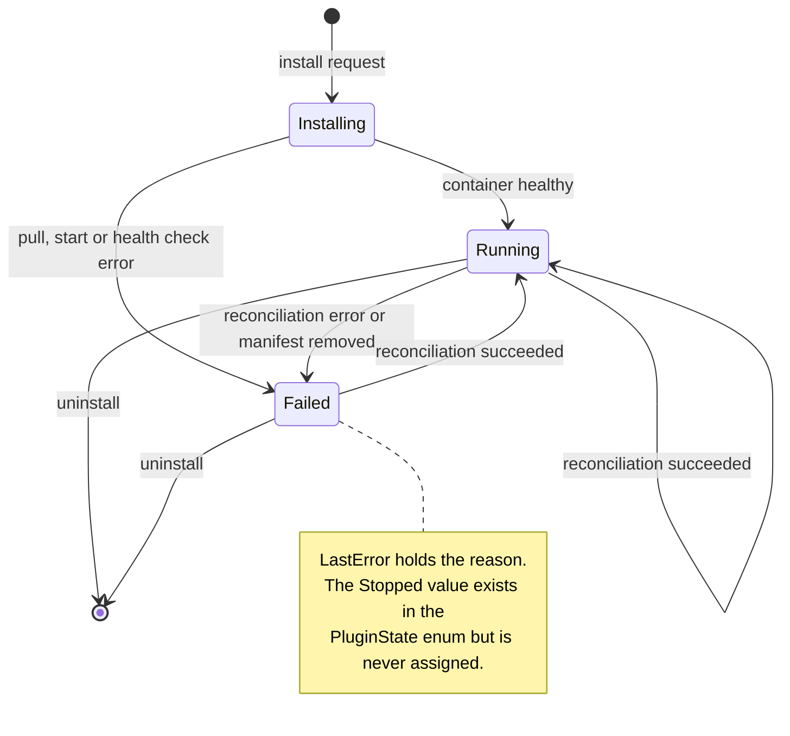

---

## 7. Deployment View

### 7.1 Infrastructure level 1 — single Docker host

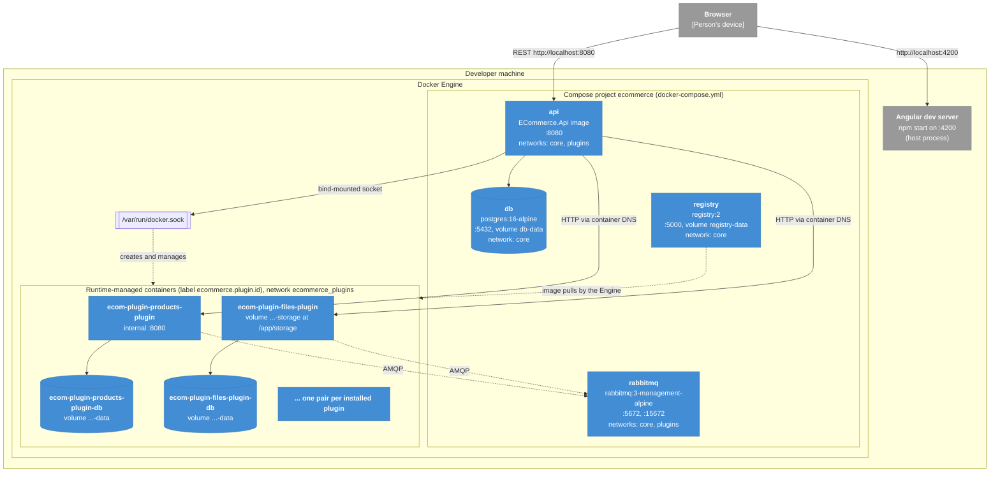

| Node / artefact | Image | Host port | Network(s) | Persistent data |
|---|---|---|---|---|
| `api` | built from [backend/Dockerfile](../backend/Dockerfile) (SDK 10 build → ASP.NET 10 runtime; copies `marketplace/`) | 8080 | `ecommerce_core`, `ecommerce_plugins` | — (bind mount `/var/run/docker.sock`) |
| `db` | `postgres:16-alpine` | 5432 | `ecommerce_core` | `db-data` |
| `rabbitmq` | `rabbitmq:3-management-alpine` | 5672, 15672 | `ecommerce_core`, `ecommerce_plugins` | — |
| `registry` | `registry:2` (delete enabled) | 5000 | `ecommerce_core` | `registry-data` |
| `ecom-plugin-<id>` | manifest `image` | none in container mode; random in host mode | `ecommerce_plugins` | `ecom-plugin-<id>-storage` if `storage` declared |
| `ecom-plugin-<id>-db` | manifest `database.image` | none | `ecommerce_plugins` | `ecom-plugin-<id>-data` |
| `*-plugin-db` Compose services | `postgres:16-alpine` | 5433–5438 | `ecommerce_plugins` | `*-plugin-db-data` — **legacy, not used by the runtime** |
| `*-plugin-image` Compose services | built inline | — | — | profile `plugin-images`; used only to build and push images |

### 7.2 Dual networking mode

The same core binary supports two development modes. The mode is detected at runtime by checking for
`/.dockerenv`.

| | Mode A — core in Compose | Mode B — core on the host (`dotnet run` / `dotnet watch`) |
|---|---|---|
| Core → plugin address | `http://ecom-plugin-<id>:8080` (container DNS on `ecommerce_plugins`) | `http://localhost:<random published port>` |
| Plugin host port | not published | published on all host interfaces with a random port |
| Core database | `Host=db` | `Host=localhost` (`appsettings.Development.json`) |
| Broker address given to plugins | `rabbitmq` (resolved on `ecommerce_plugins`) | `rabbitmq` (same — plugins still run in Docker) |
| Switching modes | Reconciliation treats a container without a published port as incompatible in Mode B and recreates it; volumes survive, no reinstall required. | ← same |

### 7.3 Plugin delivery pipeline

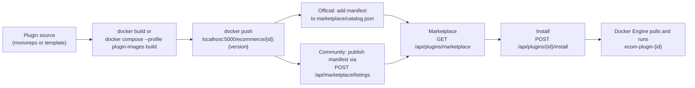

Official manifests are baked into the core image (`COPY marketplace/`), so changing the official catalogue
requires rebuilding the core; community listings do not. Note that the README quick start omits
`files-plugin-image` from its build/push list even though the Compose file defines it.

---

## 8. Cross-cutting Concepts

### 8.1 Identity, authentication and authorisation

**Authentication** is centralised in the core. `AuthService` stores BCrypt password hashes and issues
HS256 JWTs (issuer `ecommerce-core`, audience `ecommerce-clients`, 60 min lifetime, 30 s clock skew) with
three claims: `sub` (user id), `email`, and `role`. Inbound claim mapping is disabled, so the short claim
names are used as-is (`RoleClaimType = "role"`). There are no refresh tokens; a role change takes effect
only after the user signs in again.

**Roles**: `user` (default on registration), `publisher` (granted by approving a publisher request),
`admin` (bootstrap account `admin@ecommerce.local`, or `POST /api/auth/users/role`).

**Trusted-subsystem propagation to plugins.** Plugins do not validate JWTs. After authenticating the
request, the core forwards the identity as plain headers:


- The generic proxy forwards only the body, `Content-Type` and these two headers; client-supplied
  headers (including `Authorization` and any spoofed `X-User-*`) are **not** forwarded.
- The typed controllers additionally rewrite `me` in the path to the caller's `sub`.
- The model is sound only while plugins are unreachable except through the core — see R-05 in
  [§11](#11-risks-and-technical-debt).

**Authorisation matrix (as implemented).**

| Operation | Anonymous | `user` | `publisher` | `admin` |
|---|:-:|:-:|:-:|:-:|
| Register, login | ✔ | ✔ | ✔ | ✔ |
| `dev-login`, `seed-user`, `promote-admin` | ✔ ⚠ | ✔ ⚠ | ✔ ⚠ | ✔ |
| Browse marketplace (`/api/plugins/marketplace`, `GET /api/marketplace/listings`) | ✔ | ✔ | ✔ | ✔ |
| List / install / uninstall plugins (`/api/plugins`) | — | ✔ ⚠ | ✔ ⚠ | ✔ |
| Request publisher access, see own request | — | ✔ | ✔ | ✔ |
| Publish, update, delete own listings | — | — | ✔ | ✔ |
| Review publisher requests, change roles | — | — | — | ✔ |
| Any plugin API via `/api/p/{pluginId}/...` (products CRUD, carts, payments, orders, files) | — | ✔ | ✔ | ✔ |
| `PATCH` order status, read Stripe webhook log | — | ✔ ⚠ | ✔ ⚠ | ✔ |
| Stripe webhook, product images (`/static/images/...`) | ✔ | ✔ | ✔ | ✔ |

⚠ = broader than the UI suggests. The web client hides admin pages behind `adminGuard`, but the API itself
only checks for an authenticated user. The UI is not a security boundary.

### 8.2 Plugin contract

A plugin is any OCI image that satisfies this contract. Nothing else about its technology is prescribed.

| Obligation | Detail |
|---|---|
| Manifest | A `plugin.json` matching `PluginManifest`: id must match `^[a-z0-9]+(?:-[a-z0-9]+)*-plugin$`, image, container port, health endpoint, optional database and storage. |
| HTTP | Listen on `containerPort` (8080 for all bundled plugins). The gateway strips `/api/p/{pluginId}`, so a plugin serves its routes from `/`. |
| Health | Return 2xx on `healthEndpoint` within `HealthTimeout` (default 30 s; polled every second) or the install fails. |
| Identity | Treat `X-User-Id` / `X-User-Email` as the authenticated caller. Do not expose ports publicly. |
| Persistence | Create its own schema on start (all bundled plugins use `EnsureCreatedAsync`). |
| Events | Use `IntegrationEventEnvelope` and `EventNames` from `ECommerce.IntegrationContracts`. Declare and bind its own durable queue. |

**Environment injected by `DockerPluginRuntime`**:

| Variable | When | Purpose |
|---|---|---|
| `ECOMMERCE_PLUGIN_ID` | always | The plugin's id |
| `RabbitMq__Host`, `__Port`, `__Username`, `__Password`, `__VirtualHost` | always | Broker connection (shared credentials) |
| `ConnectionStrings__Default` | manifest declares `database` | Connection string for the sidecar `ecom-plugin-<id>-db` |
| `Stripe__SecretKey`, `STRIPE_WEBHOOK_SECRET` | configured on the core | Passed to **every** plugin, not only `payment-plugin` (R-06) |
| volume `ecom-plugin-<id>-storage` | manifest declares `storage` | Mounted at `storage.volumeMountPath` |

### 8.3 Integration events and messaging

All plugins share a single durable **topic exchange** `ecommerce.integration-events`. The routing key is
the versioned event name. Each consuming plugin owns one durable queue and binds the keys it needs.

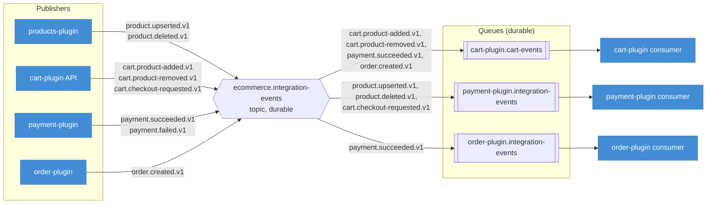

**Event catalogue.** Every envelope also carries `ResourceIds` (`ProductId`, `CartId`, `UserId`,
`PaymentId`, `OrderId`; null where not applicable) so consumers can correlate without parsing the payload.

| Event (routing key) | Producer | Payload | Consumers → effect |
|---|---|---|---|
| `product.upserted.v1` | products-plugin | `ProductId, Price, CurrencyCode ("USD"), UpdatedAtUtc` | payment → upsert price projection |
| `product.deleted.v1` | products-plugin | `ProductId, DeletedAtUtc` | payment → delete price projection |
| `cart.product-added.v1` | cart-plugin API | `CartItemId, Quantity, ProductId, AddedAtUtc` | cart consumer → create cart / add quantity |
| `cart.product-removed.v1` | cart-plugin API | `CartItemId, Quantity, ProductId, RemovedAtUtc` | cart consumer → decrease / remove item |
| `cart.checkout-requested.v1` | cart-plugin API | `UserId, CurrencyCode, PaymentMethod, Items[ProductId, Quantity], RequestedAtUtc` | payment → price, charge, record |
| `payment.succeeded.v1` | payment-plugin | `PaymentId, ProviderReference, Amount, CurrencyCode, PaymentMethod, Items[ProductId, Quantity, UnitPrice, LineTotal], PaidAtUtc` | order → create order; cart → delete cart |
| `payment.failed.v1` | payment-plugin | `PaymentId, Reason, FailedAtUtc` | **none** |
| `order.created.v1` | order-plugin | `OrderId, UserId, CartId, PaymentId, TotalAmount, CurrencyCode, CreatedAtUtc` | cart → delete cart (idempotent) |
| `OrderPaymentRequestedEvent` | — | legacy record, no event name | unused |

**Contract evolution.** The version is part of both the namespace (`ECommerce.IntegrationContracts.V1`)
and the routing key (`*.v1`), and every envelope carries `SchemaVersion = "1.0"`. A breaking change is
introduced as a new `V2` namespace and a `*.v2` routing key, so old and new consumers can coexist on the
same exchange during migration. Additive changes (new optional fields) remain `v1`, because
`System.Text.Json` ignores unknown properties.

**Delivery semantics.** Publishers use persistent messages on a durable exchange. Consumers use manual
acknowledgement: `BasicAck` on success, `BasicNack(requeue: false)` on any exception. No dead-letter exchange
is configured, so a rejected message is **discarded**. No prefetch limit (`BasicQos`) is set. Each plugin
contains its own copy of the RabbitMQ publisher/consumer plumbing (R-18).

### 8.4 Consistency and idempotency

There are no distributed transactions. Each plugin commits locally and publishes afterwards, so the system
is **eventually consistent**, with the guarantees below.

| Step | Guarantee | Mechanism |
|---|---|---|
| Add / remove cart item | At-most-once effect per delivery; a failure loses the change | Async consumer, `Nack` without requeue |
| Checkout → payment | One payment per checkout | `PaymentRecord.CorrelationId` unique; consumer skips an already-processed `CorrelationId` |
| Payment → order | One order per payment | `Order.PaymentId` and `Order.CorrelationId` unique; `OrderService` returns early if the payment exists; totals are cross-checked (`OrderServiceTests`) |
| Payment → cart clean-up | Idempotent | Delete only when `CartId` matches; `order.created.v1` triggers the same no-op delete |
| Product → price projection | Last-writer-wins, unordered | Upsert without comparing `UpdatedAtUtc`; projection is not rebuilt from history |
| DB write + publish | **Not atomic** | No transactional outbox. A crash between commit and publish loses the event (R-12). |
| Stripe webhook | De-duplicated | `StripeWebhookRecord.EventId` primary key |

### 8.5 Persistence — database per plugin

Each bounded context owns a separate PostgreSQL **instance** (not only a schema). The core uses the
Compose `db` service. Each plugin that declares `database` gets a sidecar `ecom-plugin-<id>-db` with a
named volume. No database is shared, and there are no cross-database foreign keys. Data that one plugin
needs from another is copied through events (e.g. `ProductPriceProjection`).

Schemas are created with `EnsureCreatedAsync()` at start-up in the core and in every plugin. There are no
EF Core migrations, so schema changes on existing volumes require manual intervention (ADR-011, R-19).

**Core database (`ecommerce`).** Relationships are logical only (no FK constraints):

```mermaid
erDiagram
    USER {
        guid Id PK
        string Email UK
        string PasswordHash
        string Role "user, publisher or admin"
        datetime CreatedAt
    }
    PLUGIN_INSTALLATION {
        guid Id PK
        string PluginId UK
        string Version
        string Image
        string ContainerName
        int ContainerPort
        string State "Installing, Running, Failed"
        string LastError
        string GrantedPermissionsJson
        datetime InstalledAt
        datetime UpdatedAt
    }
    MARKETPLACE_LISTING {
        guid Id PK
        string PluginId UK
        string Name
        string Version
        string Publisher
        string Image
        int ContainerPort
        string HealthEndpoint
        string PermissionsJson
        string DatabaseJson
        string StorageJson
        string UiExtensionsJson
        guid PublishedByUserId "indexed"
        datetime PublishedAt
        datetime UpdatedAt
    }
    PUBLISHER_REQUEST {
        guid Id PK
        guid UserId "indexed"
        string Message "max 1000"
        string Status "pending, approved, rejected"
        datetime CreatedAt
        datetime ReviewedAt
        guid ReviewedByUserId
    }
    USER ||..o{ PUBLISHER_REQUEST : "submits"
    USER ||..o{ MARKETPLACE_LISTING : "publishes"
    MARKETPLACE_LISTING |o..o| PLUGIN_INSTALLATION : "installed as"
```

**Plugin databases.**

```mermaid
erDiagram
    CART {
        guid Id PK
        string UserId UK
        datetime CreatedAtUtc
        datetime UpdatedAtUtc
    }
    CART_ITEM {
        guid Id PK
        guid CartId FK
        string ProductId "unique with CartId"
        int Quantity
    }
    CART ||--o{ CART_ITEM : "contains, cascade delete"

    PRODUCT {
        string Id PK
        string Code
        string Name
        string Description
        decimal Price "12,2"
        int Quantity
        string InventoryStatus "indexed"
        string Category
        string ImageFileName
        int Rating
    }

    PAYMENT_RECORD {
        guid Id PK
        string UserId
        string CorrelationId UK
        decimal Amount
        string CurrencyCode
        string Status
        string PaymentMethod
        string ProviderReference
        string FailureReason
        datetime CreatedAtUtc
    }
    PRODUCT_PRICE_PROJECTION {
        string ProductId PK
        decimal Price
        string CurrencyCode
        datetime UpdatedAtUtc
    }
    STRIPE_WEBHOOK_RECORD {
        string EventId PK
        string EventType
        string ProviderReference
        decimal Amount
        string Status
        datetime ReceivedAtUtc
    }

    ORDER {
        guid Id PK
        string UserId
        string CartId
        string PaymentId UK
        string CorrelationId UK
        string Status "OrderStatus enum as string"
        decimal TotalAmount
        string CurrencyCode
        datetime PaidAtUtc
        datetime CreatedAtUtc
    }
    ORDER_ITEM {
        guid Id PK
        guid OrderId FK
        string ProductId
        int Quantity
        decimal UnitPrice
        decimal LineTotal
    }
    ORDER ||--o{ ORDER_ITEM : "contains"
```

| Database | Owner | Entities | Notes |
|---|---|---|---|
| `ecommerce` | core | `User`, `PluginInstallation`, `MarketplaceListing`, `PublisherRequest` | Compose service `db` |
| `products` | products-plugin | `Product` | 10 seed products (`1000`–`1009`), inserted without publishing events |
| `cart` | cart-plugin | `Cart`, `CartItem` | One cart per user |
| `payment` | payment-plugin | `PaymentRecord`, `ProductPriceProjection`, `StripeWebhookRecord` | Projection is a read model of products |
| `orders` | order-plugin | `Order`, `OrderItem` | Line items copied from `payment.succeeded.v1` |
| `files` | files-plugin | — | Declared in the manifest, but the plugin has no data access. Images live on the storage volume. |

### 8.6 Configuration and secrets

| Source | Precedence | Used for |
|---|---|---|
| `appsettings.json` | lowest | Defaults: JWT, bootstrap admin, `PluginRuntime` (network, registry, broker), CORS |
| `appsettings.Development.json` | dev only | `localhost` connection string, relative `CatalogPath` |
| `.env` (cwd or `../../`) | sets env vars only if not already set | Stripe keys. `Stripe__SecretKey` and `PluginRuntime__StripeSecretKey` are kept in sync. Git-ignored. |
| Environment variables (`Section__Key`) | highest | Compose overrides (`ConnectionStrings__Default`, `PluginRuntime__*`, Stripe) |
| Plugin manifest | per plugin | Database name, user and password for the sidecar (plain text in `catalog.json`) |

The repository's default credentials (JWT key placeholder, bootstrap admin password,
`ecommerce/ecommerce` for PostgreSQL and RabbitMQ, per-plugin DB passwords) are **development defaults**.
They are committed in plain text (R-09).

### 8.7 Error handling and resilience

| Situation | Behaviour |
|---|---|
| Invalid credentials / missing or invalid JWT / missing role | 401 / 401 / 403 |
| Registration rejected (e.g. duplicate email) | 400 `{ error }` |
| Install: unknown plugin, missing permission grant, already installed | 400 `{ error }` |
| Install: pull, start or health failure | 200 with `state: "Failed"` and `lastError` (DB sidecar removed) |
| Marketplace publishing errors | `MarketplaceException` → 400 / 403 / 404 / 409 |
| Proxy: plugin not installed | 404 `{ error: "Plugin not installed" }` |
| Proxy: plugin not `Running` | 503 `{ error, state }` |
| Proxy: container unreachable or timeout | Unhandled `HttpRequestException` → **500** (default `HttpClient` timeout 100 s) (R-16) |
| Proxy: plugin returns an error | Status and body passed through unchanged |
| Consumer throws | Logged, `Nack` without requeue → message dropped (R-11) |
| Plugin or DB container crashes | Docker restart policy `unless-stopped` restarts it. There are no in-process retries, so a plugin that starts before RabbitMQ is ready crashes and is restarted. |
| Core restarts | `PluginReconciliationHostedService` restarts and re-addresses installed plugins and isolates per-plugin failures |
| Optional UI widget fails | Hidden (`StoreBanner`) |

### 8.8 Observability

- **Logging**: default ASP.NET Core console logging via `ILogger` in the core and all plugins. Read with
  `docker logs ecom-plugin-<id>` or `docker compose logs api`. There is no central log aggregation.
- **Health**: core `GET /health`; each plugin's manifest `healthEndpoint` (used at install and
  reconciliation only, not continuously).
- **State**: `GET /api/plugins` returns each installation's `state` and `lastError`.
- **Messaging**: RabbitMQ management UI on `:15672` shows queues, bindings and backlogs.
- **Tracing**: no OpenTelemetry. `CorrelationId` / `CausationId` in each envelope allow manual correlation
  of a checkout across plugin logs.
- **Metrics**: none.

### 8.9 API documentation

In `Development` only, the core exposes an OpenAPI document (`MapOpenApi`), a Scalar reference UI and
Swagger UI. Plugin endpoints appear in it only through the typed proxy controllers; the generic proxy is
a single catch-all route. Plugins do not publish their own OpenAPI documents. The full core surface is
listed in [Appendix A](#appendix-a--http-api-reference).

### 8.10 Extensibility and plugin authoring

1. **Scaffold** — `dotnet new ecommerce-plugin --PluginId my-plugin --PluginName "My plugin"` using the
   template in [backend/templates/ecommerce-plugin](../backend/templates/ecommerce-plugin/) (minimal API,
   `plugin.json`, Dockerfile, contracts via `nuget.config`).
2. **Build and push** the image to the registry.
3. **Publish** the manifest — via the portal (community) or `catalog.json` (official).
4. **Install** from the admin marketplace — no core rebuild or restart.
5. **UI** — the web client has no runtime UI composition. A plugin's UI must be compiled into the SPA as a
   component that calls `/api/p/{id}/...` and degrades gracefully when absent (`StoreBanner`). The
   manifest's `uiExtensions` is stored but not consumed.

See [PLUGIN_AUTHOR.md](../PLUGIN_AUTHOR.md) for the step-by-step guide and
[backend/community/banner-plugin](../backend/community/banner-plugin/) for a worked example.

### 8.11 Testing

| Level | Present | Content |
|---|---|---|
| Unit / component (backend) | ✔ | [ECommerce.Api.Tests](../backend/tests/ECommerce.Api.Tests/) — xUnit with EF Core InMemory: marketplace composition and publishing (8 tests), `OrderService` idempotency and totals (4), reconciliation failure isolation (1) |
| Contract tests (events, manifest) | — | — |
| Integration (Docker, RabbitMQ, PostgreSQL) | — | Verified manually through the running Compose stack |
| Front-end | — | No `*.spec.ts` files |

Run: `dotnet test backend/ECommerce.sln`.

---

## 9. Architecture Decisions

The decisions below are reconstructed from the implementation. The listed alternatives are the main
options reviewed afterwards for this document; the repository does not record them. All are **Accepted**
(implemented) unless noted otherwise.

| ADR | Decision | Primary quality goal |
|---|---|---|
| [ADR-001](#adr-001--plugins-run-out-of-process-as-containers) | Plugins run out-of-process as containers | Isolation, extensibility |
| [ADR-002](#adr-002--manage-containers-through-the-docker-engine-api) | Manage containers through the Docker Engine API | Simplicity |
| [ADR-003](#adr-003--one-database-instance-per-plugin) | One database instance per plugin | Data isolation |
| [ADR-004](#adr-004--core-acts-as-the-api-gateway) | Core acts as the API gateway | Single entry point, security |
| [ADR-005](#adr-005--trusted-subsystem-identity-propagation) | Trusted-subsystem identity propagation | Plugin simplicity |
| [ADR-006](#adr-006--event-choreography-over-a-rabbitmq-topic-exchange) | Event choreography over a RabbitMQ topic exchange | Loose coupling |
| [ADR-007](#adr-007--versioned-shared-contract-libraries) | Versioned shared contract libraries | Interoperability |
| [ADR-008](#adr-008--composite-marketplace-where-official-wins) | Composite marketplace where official wins | Extensibility, trust |
| [ADR-009](#adr-009--reconcile-plugin-state-at-start-up) | Reconcile plugin state at start-up | Recoverability |
| [ADR-010](#adr-010--typed-proxy-controllers-for-first-party-plugins) | Typed proxy controllers for first-party plugins | Developer experience |
| [ADR-011](#adr-011--create-schemas-with-ensurecreated) | Create schemas with `EnsureCreated` | Simplicity |

### ADR-001 — Plugins run out-of-process as containers

- **Context.** Plugins must be added, removed and updated at runtime by third parties without rebuilding
  the core. A faulty plugin must not crash the platform.
- **Decision.** Each plugin is an OCI image run as its own container and reached over HTTP.
- **Alternatives.** In-process assemblies (`AssemblyLoadContext`, MEF); WebAssembly modules; serverless
  functions.
- **Consequences.** ➕ Process, memory and dependency isolation; any language; independent release
  cadence; uninstall is clean. ➖ Network hop per call; requires Docker; resource overhead per plugin;
  no shared transactions; UI cannot be loaded from the plugin (see §8.10).

### ADR-002 — Manage containers through the Docker Engine API

- **Context.** The core must create, start, inspect and remove containers, networks and volumes
  programmatically.
- **Decision.** `DockerPluginRuntime` talks to the local Docker Engine through `Docker.DotNet` and the
  mounted `/var/run/docker.sock`. It is hidden behind `IPluginRuntime`.
- **Alternatives.** Kubernetes API (Deployments, Services); Docker Compose invoked as a process; Nomad.
- **Consequences.** ➕ Minimal infrastructure; easy to run on a laptop; replaceable through
  `IPluginRuntime`. ➖ Single host only; no scheduling or high availability; socket access is
  root-equivalent on the host (R-10).

### ADR-003 — One database instance per plugin

- **Context.** Plugins are independent bounded contexts and potentially untrusted.
- **Decision.** A manifest may declare `database`. The runtime then starts a dedicated PostgreSQL sidecar
  `ecom-plugin-<id>-db` with its own volume and injects `ConnectionStrings__Default`.
- **Alternatives.** Schema-per-plugin in the core database; a shared database server with
  per-plugin users; plugin-managed external databases.
- **Consequences.** ➕ Strong isolation; no accidental coupling; uninstall removes the container while
  keeping data. ➖ One PostgreSQL process per plugin; cross-plugin data must be replicated by events;
  credentials come from the manifest in plain text.

### ADR-004 — Core acts as the API gateway

- **Context.** The browser should talk to a single origin with a single authentication scheme. Plugins
  should not be publicly reachable.
- **Decision.** All plugin traffic goes through `/api/p/{pluginId}/{**path}` on the core. The core
  resolves the installation, checks its state, and forwards to the container address.
- **Alternatives.** YARP or a dedicated gateway (Traefik, Envoy) with dynamic configuration; direct
  browser-to-plugin calls with CORS.
- **Consequences.** ➕ One origin, one CORS policy, central JWT validation, plugins hidden on an internal
  network. ➖ The core sits on the data path (single point of failure, extra latency); bodies are buffered
  in memory; unreachable plugins surface as 500 (R-16, R-23).

### ADR-005 — Trusted-subsystem identity propagation

- **Context.** Plugins need to know the caller without each one implementing JWT validation.
- **Decision.** The core validates the JWT and forwards `X-User-Id` and `X-User-Email`. Plugins trust
  these headers.
- **Alternatives.** Forward the JWT and validate it in each plugin (shared key or JWKS); token exchange
  with per-plugin audiences; mutual TLS.
- **Consequences.** ➕ Trivial for plugin authors in any language. ➖ Security relies entirely on network
  isolation; any process that can reach a plugin can impersonate any user (R-05); roles are not
  propagated, so plugins cannot make role-based decisions.

### ADR-006 — Event choreography over a RabbitMQ topic exchange

- **Context.** Business processes (checkout) span several plugins that must stay independently deployable.
- **Decision.** Plugins publish versioned integration events to one durable topic exchange and react to
  each other's events. No central orchestrator coordinates them.
- **Alternatives.** Synchronous REST calls between plugins; an orchestrated saga (e.g. in the core or a
  workflow engine); Kafka.
- **Consequences.** ➕ Producers do not know their consumers; new plugins can join by binding a queue;
  temporal decoupling. ➖ Eventual consistency; no outbox or dead-letter queue yet (R-11, R-12);
  end-to-end flow is harder to trace; late subscribers miss earlier events (R-13).

### ADR-007 — Versioned shared contract libraries

- **Context.** The core and plugins must agree on the manifest and on event schemas.
- **Decision.** `ECommerce.PluginContracts` (manifest) and `ECommerce.IntegrationContracts` (namespace
  `V1`, envelope, event names, payloads). Both are packable as NuGet packages and consumed by the
  template and community plugins.
- **Alternatives.** JSON Schema / AsyncAPI documents with code generation; a schema registry.
- **Consequences.** ➕ Compile-time safety for .NET plugins; one place to evolve schemas; explicit
  versioning. ➖ Non-.NET plugins must re-implement the contracts by hand; there are no automated contract
  tests.

### ADR-008 — Composite marketplace where official wins

- **Context.** The platform ships first-party plugins and must also accept third-party listings without
  allowing them to impersonate official ones.
- **Decision.** `CompositeMarketplaceCatalog` merges `BundledMarketplaceSource` (`catalog.json`) and
  `DatabaseMarketplaceSource` (published listings). On an id collision the official entry wins.
  Publishing an official id is rejected with 409. A failing source is skipped.
- **Alternatives.** A single database-backed catalogue seeded from JSON; a remote marketplace service.
- **Consequences.** ➕ Official plugins cannot be shadowed; community publishing needs no core release;
  covered by tests. ➖ Changing the official catalogue requires rebuilding the core image; listings are not
  reviewed and images are not signed or scanned (R-10).

### ADR-009 — Reconcile plugin state at start-up

- **Context.** After a core or host restart, or after switching between networking modes, the persisted
  installation records and the real containers can diverge.
- **Decision.** `PluginReconciliationHostedService` runs once at start-up. For each installation it
  re-resolves the manifest, ensures the containers are running and reachable, updates the state, and
  isolates failures per plugin.
- **Alternatives.** A periodic control loop (Kubernetes-style); Docker event subscription.
- **Consequences.** ➕ Self-healing after restarts; supports both networking modes; tested. ➖ Drift during
  normal operation is not detected until the next start-up (R-15).

### ADR-010 — Typed proxy controllers for first-party plugins

- **Status.** Accepted; recommended for revision.
- **Context.** The generic proxy cannot document plugin endpoints in OpenAPI, validate input, or map the
  symbolic `me` to the caller.
- **Decision.** The core contains controllers for each first-party plugin (`ProductsPluginController`,
  `CartPluginController`, `PaymentPluginController`, `OrderPluginController`, `FilesPluginController`).
  They use the same `/api/p/{pluginId}/...` prefix, take precedence over the catch-all route, and forward
  explicitly.
- **Alternatives.** Plugins expose their own OpenAPI documents, which the core aggregates; a `me` rewrite
  rule in the generic proxy; a backend-for-frontend per plugin.
- **Consequences.** ➕ Typed, documented API for the web client; `me` is mapped to `sub` in the core;
  payment input is validated before checkout. ➖ The core is compiled against first-party plugin routes,
  which contradicts the "no core change" goal for those plugins; forwarding logic is duplicated five
  times; `PaymentPluginController` couples payment to `cart-plugin` (R-17).

### ADR-011 — Create schemas with `EnsureCreated`

- **Status.** Accepted for the prototype; recommended for revision.
- **Context.** Fast iteration on a prototype with throw-away databases.
- **Decision.** The core and every plugin call `Database.EnsureCreatedAsync()` at start-up.
- **Alternatives.** EF Core migrations applied at start-up or by a deployment step.
- **Consequences.** ➕ Zero ceremony. ➖ Existing databases are never altered; any model change on a
  persisted volume requires dropping the volume or manual SQL (R-19).

---

## 10. Quality Requirements

### 10.1 Quality tree

```mermaid
flowchart LR
    q(("Quality"))
    q --> ext["Extensibility"]
    q --> iso["Isolation"]
    q --> dep["Deployability"]
    q --> rec["Recoverability"]
    q --> con["Consistency"]
    q --> sec["Security"]
    ext --> q1["Q1 New plugin without core change"]
    ext --> q9["Q9 Contract-based interoperability"]
    iso --> q3["Q3 Fault isolation"]
    iso --> q5["Q5 Data isolation"]
    dep --> q2["Q2 Bounded install time"]
    rec --> q4["Q4 Recovery after restart"]
    rec --> q7["Q7 Graceful UI degradation"]
    con --> q6["Q6 Exactly one order per payment"]
    con --> q10["Q10 No silent message loss"]
    sec --> q8["Q8 No privilege escalation"]

    classDef met fill:#2e7d32,stroke:#1b5e20,color:#ffffff
    classDef partial fill:#f9a825,stroke:#f57f17,color:#000000
    classDef notmet fill:#c62828,stroke:#8e0000,color:#ffffff
    class q1,q9,q2,q4,q7,q6 met
    class q3,q5 partial
    class q8,q10 notmet
```

Legend: green = met, amber = partially met, red = not met by the current implementation.

### 10.2 Quality scenarios

| ID | Quality | Scenario (stimulus → expected response) | Status | Evidence |
|---|---|---|---|---|
| Q1 | Extensibility | A developer scaffolds a plugin from the template, pushes the image, and publishes the manifest. An admin installs it → it is reachable under `/api/p/{id}` with **no core code change, rebuild or restart**. | ✅ Met | `banner-plugin` (§6.8) |
| Q2 | Deployability | An admin installs a published plugin → the installation is `Running` or `Failed` (with `lastError`) at most `HealthTimeout` = 30 s after the container starts. | ✅ Met | `WaitForHealthyAsync` |
| Q3 | Fault isolation | A plugin container crashes during operation → the core and other plugins keep serving; the plugin is restarted automatically; clients get a clear error meanwhile. | 🟡 Partial | Restart policy works, but the state stays `Running` and callers get **500** instead of 503 (R-16). |
| Q4 | Recoverability | The core restarts or switches networking mode → every installed plugin becomes `Running` again without reinstalling or losing data. | ✅ Met | Reconciliation (§6.2) + `PluginReconciliationHostedServiceTests` |
| Q5 | Data isolation | A plugin tries to read another plugin's data → impossible. | 🟡 Partial | Separate DB instances, but all sidecars share `ecommerce_plugins` and passwords are in the public manifest (R-05, R-08). |
| Q6 | Consistency | `payment.succeeded.v1` is delivered twice → exactly one order exists. | ✅ Met | Unique `PaymentId` / `CorrelationId` + `OrderServiceTests` |
| Q7 | Graceful degradation | An optional plugin is uninstalled or stopped → the storefront still renders, minus that widget. | ✅ Met | `StoreBanner` (§6.9) |
| Q8 | Security | An anonymous or `user` caller tries to obtain admin rights → refused. | ❌ Not met | `POST /api/auth/promote-admin` is anonymous (R-01) |
| Q9 | Interoperability | A plugin built in a separate repository uses only the contract packages → it is listed, installed and exchanges data correctly. | ✅ Met | `banner-plugin` builds against local NuGet packages |
| Q10 | Reliability | A consumer fails while processing an event → the message is kept for retry or inspection. | ❌ Not met | `Nack(requeue: false)` with no DLX (R-11) |

---

## 11. Risks and Technical Debt

Severity reflects impact if the system were exposed beyond a local development machine.

### 11.1 Security

| ID | Risk / debt | Severity | Evidence | Suggested mitigation |
|---|---|---|---|---|
| R-01 | **Anonymous privilege escalation**: `POST /api/auth/promote-admin` is `[AllowAnonymous]` and makes any account admin. | 🔴 Critical | [AuthController.cs](../backend/src/ECommerce.Api/Controllers/AuthController.cs) | Remove, or restrict to `admin` / Development only |
| R-02 | `dev-login` (hard-coded credentials) and `seed-user` are anonymous and active in every environment. | 🟠 High | [AuthController.cs](../backend/src/ECommerce.Api/Controllers/AuthController.cs) | Map only when `IsDevelopment()` |
| R-03 | Any authenticated user can install and uninstall plugins (i.e. start containers on the host). | 🟠 High | [PluginsController.cs](../backend/src/ECommerce.Api/Controllers/PluginsController.cs) | `[Authorize(Roles = "admin")]` |
| R-04 | Any authenticated user can list **all** orders (`GET /orders`), change order status, read the Stripe webhook log, and create, update or delete products. | 🟠 High | [OrderPluginController.cs](../backend/src/ECommerce.Api/Controllers/OrderPluginController.cs), [PaymentPluginController.cs](../backend/src/ECommerce.Api/Controllers/PaymentPluginController.cs), [ProductsPluginController.cs](../backend/src/ECommerce.Api/Controllers/ProductsPluginController.cs) | Role checks in the core; forward a role header |
| R-05 | Header-based identity is forgeable by anything that can reach a plugin. In host mode, plugin ports are published on **all** host interfaces; in container mode, every plugin shares `ecommerce_plugins` with every other plugin and DB. | 🟠 High | [DockerPluginRuntime.cs](../backend/src/ECommerce.PluginRuntime/DockerPluginRuntime.cs) | Bind to `127.0.0.1`; per-plugin networks; signed internal token |
| R-06 | Stripe secret key and webhook secret are injected into **every** plugin, including community plugins. | 🟠 High | `BuildPluginEnvironment` | Inject only when the manifest requests and the admin grants it |
| R-07 | All plugins share one broker account, so any plugin can publish any event (e.g. forge `payment.succeeded.v1` to create orders). | 🟠 High | `appsettings.json` `PluginRuntime:Broker*` | Per-plugin vhost permissions / topic authorisation |
| R-08 | Manifest `permissions` must be "granted" at install but are **not enforced**; `hostApi` is informational. | 🟡 Medium | [PluginService.cs](../backend/src/ECommerce.Api/Plugins/PluginService.cs) | Map permissions to network, secret and broker rights |
| R-09 | Development secrets committed: JWT key placeholder, bootstrap admin password, DB and broker credentials, plugin DB passwords. Plugin DB passwords are also returned to **anonymous** callers by `GET /api/plugins/marketplace`, because manifests are serialised in full. | 🟡 Medium | `appsettings.json`, `docker-compose.yml`, `catalog.json`, [PluginManifest.cs](../backend/src/ECommerce.PluginContracts/PluginManifest.cs) | User secrets / env vars; generate per-install DB passwords; strip `database` from public responses |
| R-10 | The core holds `/var/run/docker.sock` (root-equivalent). Community images are unsigned, unscanned and run without resource limits. | 🟡 Medium | `docker-compose.yml` | Rootless Docker or socket proxy; image signing; CPU and memory limits |
| R-21 | Web client stores the JWT in `localStorage`, and the API base URL is hard-coded to `http://localhost:8080`. | ⚪ Low | [app.config.ts](../webclient/src/app.config.ts) | HttpOnly cookie or in-memory token; environment config |

### 11.2 Reliability and consistency

| ID | Risk / debt | Severity | Evidence | Suggested mitigation |
|---|---|---|---|---|
| R-11 | No dead-letter exchange: failed messages are discarded after one attempt. | 🟠 High | `*EventsConsumer.cs` | DLX + retry queue with back-off |
| R-12 | No transactional outbox: a crash between DB commit and publish loses the event. | 🟡 Medium | Publishers in each plugin | Outbox table + relay |
| R-13 | Events published before a consumer's queue exists are lost, and projections cannot be rebuilt. Seed products never emit `product.upserted.v1`, so they cannot be checked out until edited. Currency is hard-coded to `USD`. | 🟡 Medium | products-plugin seeding, `ProductEventPublisher` | Declare queues at install; projection rebuild endpoint; publish on seed |
| R-14 | `payment.failed.v1` has no subscriber; the user is not notified and the saga simply stops. | ⚪ Low | §8.3 | Consume in cart/order or the UI |
| R-15 | Reconciliation runs only at start-up; state drift during operation is not detected. | 🟡 Medium | [PluginReconciliationHostedService.cs](../backend/src/ECommerce.Api/Plugins/PluginReconciliationHostedService.cs) | Periodic loop or Docker events |
| R-16 | The proxy has no error handling or timeout policy: unreachable plugins produce 500 after up to 100 s. | 🟡 Medium | [PluginProxyController.cs](../backend/src/ECommerce.Api/Controllers/PluginProxyController.cs) | Catch → 502/504; short timeout; circuit breaker |

### 11.3 Maintainability and evolvability

| ID | Risk / debt | Severity | Evidence | Suggested mitigation |
|---|---|---|---|---|
| R-17 | Typed proxy controllers couple the core to first-party plugins and duplicate the forwarding code five times. | 🟡 Medium | `*PluginController.cs` | Shared forwarder; plugin-provided OpenAPI (ADR-010) |
| R-18 | RabbitMQ publisher and consumer plumbing is copy-pasted in each plugin. | ⚪ Low | `*/Infrastructure/Messaging` | Shared messaging package next to the contracts |
| R-19 | `EnsureCreated` instead of migrations. | 🟡 Medium | `Program.cs`, `*DatabaseInitializer.cs` | EF Core migrations |
| R-20 | Dead or misleading artefacts: Compose `*-plugin-db` services (unused), files-plugin DB (unused), `PluginState.Stopped`, `OrderPaymentRequestedEvent`, manifest `uiExtensions` (not consumed). | ⚪ Low | various | Remove or implement |
| R-25 | Plugin volumes are kept after uninstall, and deleting a listing does not uninstall running instances. The README quick start omits `files-plugin-image`. | ⚪ Low | `DockerPluginRuntime.StopAsync`, [README.md](../README.md) | Optional "purge data"; cascade or warn; fix README |

### 11.4 Performance and usability

| ID | Risk / debt | Severity | Evidence | Suggested mitigation |
|---|---|---|---|---|
| R-22 | Every proxied request re-reads `catalog.json` and queries listings to resolve the manifest. | ⚪ Low | `PluginService.ResolveAsync` | Cache manifests and invalidate on publish/install |
| R-23 | Request bodies, including multipart uploads, are fully buffered in memory before forwarding. | ⚪ Low | [PluginProxyController.cs](../backend/src/ECommerce.Api/Controllers/PluginProxyController.cs) | Stream the body (YARP) |
| R-24 | The storefront route is public, but product endpoints require a JWT, so guests cannot browse. | 🟡 Medium | [ProductsPluginController.cs](../backend/src/ECommerce.Api/Controllers/ProductsPluginController.cs) | `[AllowAnonymous]` on product reads |

---

## 12. Glossary

| Term | Definition |
|---|---|
| **Core** | The ASP.NET Core host (`ECommerce.Api` and its libraries): identity, marketplace, plugin lifecycle, gateway. Contains no shop domain logic. |
| **Plugin** | An independently built OCI image that implements one bounded context (products, cart, …) and fulfils the [plugin contract](#82-plugin-contract). |
| **Manifest** | The `plugin.json` / `PluginManifest` describing a plugin: id, image, port, health endpoint, database, storage, permissions. |
| **Official / bundled plugin** | A plugin whose manifest ships in `marketplace/catalog.json` inside the core image. |
| **Community plugin** | A plugin whose manifest was published at runtime by a `publisher` through the portal. Stored as a `MarketplaceListing`. |
| **Marketplace** | The merged catalogue of official and community manifests (`CompositeMarketplaceCatalog`). |
| **Installation** | A `PluginInstallation` record together with its running container(s). |
| **Plugin runtime** | `IPluginRuntime` / `DockerPluginRuntime` — the component that turns a manifest into running containers. |
| **Sidecar database** | The dedicated PostgreSQL container `ecom-plugin-<id>-db` created for a plugin that declares `database`. |
| **Reconciliation** | Start-up process that aligns real containers with persisted installations. |
| **Gateway / reverse proxy** | The core's `/api/p/{pluginId}/{**path}` route that forwards requests to plugin containers. |
| **Typed proxy controller** | A core controller that forwards a fixed set of first-party plugin routes (ADR-010). |
| **Trusted subsystem** | Pattern in which downstream services trust identity asserted by an upstream service (`X-User-Id`, `X-User-Email`). |
| **Integration event** | A versioned, broker-delivered message in an `IntegrationEventEnvelope`, e.g. `payment.succeeded.v1`. |
| **Choreography / saga** | A multi-step business process coordinated only by events, without a central coordinator (checkout). |
| **Projection / read model** | A local copy of another context's data maintained from events (`ProductPriceProjection`). |
| **CorrelationId / CausationId** | Envelope fields linking all events of one business transaction / pointing to the triggering event. |
| **Publisher** | A user role permitted to publish community plugin listings. |
| **Mode A / Mode B** | Core running inside Compose vs on the host (see [§7.2](#72-dual-networking-mode)). |

---

## Appendix A — HTTP API Reference

All paths are relative to the core (`http://localhost:8080`). "Auth" is what the API enforces, not what the
UI shows. ⚠ marks endpoints listed in [§11](#11-risks-and-technical-debt).

### A.1 Core

| Method | Path | Auth | Purpose |
|---|---|---|---|
| GET | `/health` | anonymous | Liveness |
| GET | `/openapi/v1.json`, `/scalar/v1`, `/swagger` | anonymous, **Development only** | API documentation |
| GET | `/static/**` | anonymous | Core static files (`storage/public`) |
| POST | `/api/auth/register` | anonymous | Create a `user` account |
| POST | `/api/auth/login` | anonymous | Obtain a JWT (401 on bad credentials) |
| GET | `/api/auth/me` | authenticated | Current user |
| POST | `/api/auth/dev-login` | anonymous ⚠ | Log in with built-in development credentials |
| POST | `/api/auth/seed-user` | anonymous ⚠ | Create a test user |
| POST | `/api/auth/promote-admin` | anonymous ⚠ | Make an account admin |
| POST | `/api/auth/users/role` | `admin` | Set a user's role |
| GET | `/api/plugins/marketplace` | anonymous | Merged catalogue with `installed` flag |
| GET | `/api/plugins` | authenticated | Installed plugins with `state`, `lastError` |
| POST | `/api/plugins/{pluginId}/install` | authenticated ⚠ | Install (400 on validation errors) |
| DELETE | `/api/plugins/{pluginId}` | authenticated ⚠ | Uninstall (204) |
| GET | `/api/marketplace/listings` | anonymous | Community listings |
| GET | `/api/marketplace/listings/mine` | `publisher`, `admin` | Caller's listings |
| GET | `/api/marketplace/listings/{pluginId}` | `publisher`, `admin` | One listing |
| POST | `/api/marketplace/listings` | `publisher`, `admin` | Publish (400 / 409) |
| PUT | `/api/marketplace/listings/{pluginId}` | `publisher`, `admin` | Update own listing (403 if not owner) |
| DELETE | `/api/marketplace/listings/{pluginId}` | `publisher`, `admin` | Delete own listing |
| POST | `/api/marketplace/publisher-requests` | authenticated | Request publisher role |
| GET | `/api/marketplace/publisher-requests/mine` | authenticated | Own request status |
| GET | `/api/marketplace/publisher-requests` | `admin` | All requests |
| POST | `/api/marketplace/publisher-requests/{id}/approve` | `admin` | Approve → role `publisher` |
| POST | `/api/marketplace/publisher-requests/{id}/reject` | `admin` | Reject |

### A.2 Gateway

| Method | Path | Auth | Forwards to |
|---|---|---|---|
| GET, POST, PUT, DELETE, PATCH | `/api/p/{pluginId}/{**path}` | authenticated | `{plugin}/{path}` with `X-User-Id`, `X-User-Email` |
| GET | `/api/p/files-plugin/static/images/{**path}` | anonymous | files-plugin static images |

### A.3 Typed first-party routes (under `/api/p`)

| Plugin | Method | Path | Notes |
|---|---|---|---|
| products-plugin | GET | `/products-plugin/health` | |
| | GET | `/products-plugin/products` | Filters `minPrice`, `maxPrice`, `availability` |
| | GET | `/products-plugin/products/greeting` | Demo |
| | GET | `/products-plugin/products/{id}` | |
| | POST, PUT, DELETE | `/products-plugin/products[/{id}]` | Any authenticated user ⚠; emits `product.*` events |
| cart-plugin | GET | `/cart-plugin/carts/me` | |
| | GET | `/cart-plugin/carts/me/items/count` | |
| | DELETE | `/cart-plugin/carts/me` | |
| | POST | `/cart-plugin/carts/me/items` | 202, async (§6.4) |
| | DELETE | `/cart-plugin/carts/me/items/{productId}?quantity=` | 202, async |
| payment-plugin | GET | `/payment-plugin/payments/me` | Caller's payments |
| | POST | `/payment-plugin/payments/me/pay` | Validates, then starts checkout in cart-plugin (§6.5) |
| | POST | `/payment-plugin/payments/webhook` | **anonymous**, Stripe signature (§6.6) |
| | GET | `/payment-plugin/payments/webhook-events` | Any authenticated user ⚠ |
| order-plugin | GET | `/order-plugin/orders` | **All** orders, any authenticated user ⚠ |
| | GET | `/order-plugin/orders/me`, `/orders/me/{orderId}` | Caller's orders |
| | GET | `/order-plugin/orders/greeting` | Demo |
| | PATCH | `/order-plugin/orders/{orderId}/status` | Any authenticated user ⚠ |
| files-plugin | GET | `/files-plugin/health`, `/files-plugin/files/greeting` | |
| | POST | `/files-plugin/files/images` | multipart field `file`, ≤ 5 MB, jpeg/png/webp/gif |
| | GET | `/files-plugin/files/images`, `/files/images/{fileName}` | Metadata |
| | DELETE | `/files-plugin/files/images/{fileName}` | |

Community plugins (e.g. `banner-plugin`: `GET /api/p/banner-plugin/banner`) are reachable only through the
generic gateway route.

---

## Appendix B — Source Map

| Concern | Location |
|---|---|
| Solution | [backend/ECommerce.sln](../backend/ECommerce.sln) |
| Core composition root | [Program.cs](../backend/src/ECommerce.Api/Program.cs), [appsettings.json](../backend/src/ECommerce.Api/appsettings.json) |
| Authentication | [AuthController.cs](../backend/src/ECommerce.Api/Controllers/AuthController.cs), [AuthService.cs](../backend/src/ECommerce.Api/Auth/AuthService.cs) |
| Plugin lifecycle | [PluginsController.cs](../backend/src/ECommerce.Api/Controllers/PluginsController.cs), [PluginService.cs](../backend/src/ECommerce.Api/Plugins/PluginService.cs), [PluginReconciliationHostedService.cs](../backend/src/ECommerce.Api/Plugins/PluginReconciliationHostedService.cs) |
| Container runtime | [DockerPluginRuntime.cs](../backend/src/ECommerce.PluginRuntime/DockerPluginRuntime.cs), [PluginRuntimeOptions.cs](../backend/src/ECommerce.PluginRuntime/PluginRuntimeOptions.cs), [PluginIdRules.cs](../backend/src/ECommerce.PluginRuntime/PluginIdRules.cs) |
| Marketplace | [MarketplaceController.cs](../backend/src/ECommerce.Api/Controllers/MarketplaceController.cs), [MarketplacePublishService.cs](../backend/src/ECommerce.Api/Plugins/MarketplacePublishService.cs), [PublisherRequestService.cs](../backend/src/ECommerce.Api/Plugins/PublisherRequestService.cs), [DatabaseMarketplaceSource.cs](../backend/src/ECommerce.Api/Plugins/DatabaseMarketplaceSource.cs), [catalog.json](../backend/marketplace/catalog.json) |
| Gateway | [PluginProxyController.cs](../backend/src/ECommerce.Api/Controllers/PluginProxyController.cs) + typed `*PluginController.cs` in [Controllers](../backend/src/ECommerce.Api/Controllers/) |
| Core persistence | [AppDbContext.cs](../backend/src/ECommerce.Infrastructure/AppDbContext.cs), [Entities](../backend/src/ECommerce.Core/Entities/) |
| Contracts | [PluginManifest.cs](../backend/src/ECommerce.PluginContracts/PluginManifest.cs), [IntegrationContracts/V1](../backend/src/ECommerce.IntegrationContracts/V1/) |
| First-party plugins | [backend/plugins](../backend/plugins/) — `products-plugin`, `cart-plugin`, `payment-plugin`, `order-plugin`, `files-plugin`, `hello-plugin` |
| Community example / template | [banner-plugin](../backend/community/banner-plugin/), [ecommerce-plugin template](../backend/templates/ecommerce-plugin/), [PLUGIN_AUTHOR.md](../PLUGIN_AUTHOR.md) |
| Deployment | [docker-compose.yml](../backend/docker-compose.yml), [Dockerfile](../backend/Dockerfile) |
| Tests | [ECommerce.Api.Tests](../backend/tests/ECommerce.Api.Tests/) |
| Web client | [app.config.ts](../webclient/src/app.config.ts), [app.routes.ts](../webclient/src/app.routes.ts), [store.routes.ts](../webclient/src/app/store/store.routes.ts), [admin.routes.ts](../webclient/src/app/admin/admin.routes.ts), [auth.guard.ts](../webclient/src/app/auth.guard.ts), [auth-token.interceptor.ts](../webclient/src/app/auth/auth-token.interceptor.ts) |
| Companion overview | [ARCHITECTURE.md](../ARCHITECTURE.md) |
